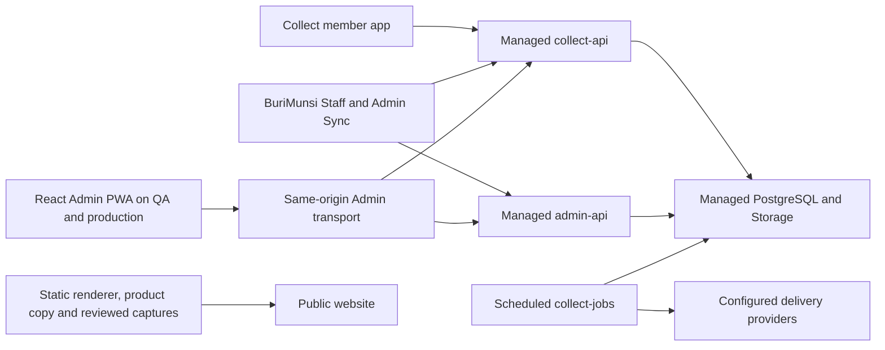

# Collect full-stack code audit

18 November 2026 · Updated 21 November 2026

**Hosted release on 20 November.** Production and QA served React Admin backed by managed Supabase. At 16:28 UTC the managed project had reopened writes at epoch 48, recorded all seven migrations and completed its ordinary minute job with HTTP 200. The 11 payment records checked that day had distinct 12-digit references. The job found zero pending receipts. An unlocked Pixel 4a passed 69 Staff and 89 Admin Sync tests and retained encrypted fixture data across both installed upgrades. Authenticated hosted roles, a real carrier receipt, distribution-signed devices and full provider-equivalent recovery remain open. [Runtime and scheduler](../implementation/2026-11-20-managed-runtime-epoch48.json) · [Handset results](../implementation/2026-11-20-burimunsi-collection-posting.json) · [Implementation plan](../plans/2026-11-18-collect-cleanup-refactoring.md)

The 20 November website browser run exercised group invitations at the configured HTTPS origin using the packaged site. Chrome passed all 60 page and 16 share cases across four viewport sizes. A valid invitation copies its canonical group link. Invalid codes leave the native action disabled. [Rendered verification](../implementation/2026-11-20-public-group-rendered-qa.json)

**Evidence availability.** The last hosted check on 20 November identified React v16 on QA and v37 on production. The owner deferred further artifact qualification while concurrent disk cleanup proceeds. The cleanup removed the older off-disk evidence folders and the incomplete Android outputs. The reviewed source and its linked Git store are now in the COLLECT workspace on PRO-G40. [Current source and custody record](../implementation/2026-11-20-source-cleanup-continuity.json)

**Dependency findings.** Five GitHub advisories pointed to Undici 7.29.1 in the retained Cloudflare API development tools. Four were high severity. The reviewed lock resolves 7.30.1. Six other alerts named a historical Ruby delivery packet. The active private member delivery lock also carried Addressable 2.9.0 and now matches the public branch at 2.9.2. [Dependency source evidence](../implementation/2026-11-20-dependency-source-review.json)

**Source verification on 21 November.** The Collect member suite passed 2,688 unit and widget tests and six additional historical SQL decoder cases on the Dart VM. React Admin passed 981 tests, type checking and linting. The Node Edge suite passed 3,827 tests and skipped seven fixture-gated cases. The latest query changes were measured on local PostgreSQL. The hosted cutover and device observations below retain their original dates. [Verification record](../implementation/2026-11-21-fullstack-source-verification.json)

**Later source follow-up on 21 November.** BuriMunsi extracted member directory and registration tasks and fenced receiver dispatch to the current operator. Managed Admin reads now cover the core projections and scoped lookups. The V1 retention refactor matched 512 predecessor cases. React separated workspace routes and sensitive verification and now ignores earlier proof during an active check. Collect separates payment-scope refresh from notification reads. The website disallows inline executable scripts in its source policy. Receiver resume now schedules protected startup and held journal checks away from the lifecycle caller. Local tests verified the actual migration isolation rule, concurrent Admin grant revocation and exact native rate counters. The running services and earlier physical evidence retain their recorded dates. [Source follow-up](../implementation/2026-11-21-source-boundary-refactor.json)

**Writer and journal follow-up on 21 November.** Disposable PostgreSQL verified the scoped Storage and session locks, the exact column privileges on seven private tables, and authorized queries for the two BuriMunsi journal links. The tests also verified rollback of an excessive inherited grant and preservation of blocked erasure. The exact MoMo15 Wrangler configuration and historical Worker inputs regenerate the original operation inventory. [Verification record](../implementation/2026-11-21-source-boundary-refactor.json)

**Auth17 source follow-up on 21 November.** The inventory now pins the reviewed versions of `admin.js`, `core.js` and `index.js`. The runtime fixes for payment evidence, unavailable queue SLAs, oversized requests and the operator source freeze are intact. The inventory check passed for 85 RPCs, seven functions, 39 route families and 17 migrations. Substituting any one of the three earlier files still triggers a refusal. Artifact qualification remains deferred. [Auth17 verification](../implementation/2026-11-21-source-boundary-refactor.json)

**T7 branch recheck on 21 November.** The native restore cases exposed obsolete header offsets, stale member viewport callbacks, and a payment readback at the pre-allocation receipt version. React regressions exposed replies and confirmations crossing an owner verification or group refresh, and overlapping MoMo inbox reads. The Storage migration limits six tables to 34 named insert columns and verifies rollback when an inherited grant supplies excess authority. Collect separates transient notification errors from verified financial results and blocks offline restoration after an HTTP access refusal even when the response body is unreadable. The Auth17 and MoMo15 source inventory checks passed. [Recheck and test evidence](../implementation/2026-11-21-source-boundary-refactor.json)

**Source admission and custody follow-up on 21 November.** An offline restore from the new PRO-G40 packet matched all 110,302 retained paths and verified executable bits inside a private destination. The member-history gate resolves its nine checked inputs from Git in a sparse checkout. Admin Sync performs final session and journal checks for queue previews off the UI caller and rejects superseded results. The cutover digest now covers the React Admin, receiver inputs and shared contracts. The product exporter binds the MoMo15 archive required by its inventory command. The offline managed planner reconciles the ordered predecessor and the three pending migrations. [Source and custody verification](../implementation/2026-11-21-source-boundary-refactor.json)

## Latest source findings and corrections

A failed replacement beneficiary search could leave the previous candidate selected in BuriMunsi. Staff and Admin Sync now clear it before dispatch, retain the submitted search and note on failure, and require a current selection before allocating the original payment. Both host suites passed on the review branch and on a 136-input snapshot that matched the launcher before and after the checks. [Allocation state owner](../../native/burimunsi/app/src/main/kotlin/rw/ikanisa/burimunsi/ui/NativeCollectionPosting.kt)

A delayed exact payment read could replace a newer Collect receipt status or pending count. The repository orders exact reads and complete recent windows under the existing session and scope checks. Four regressions reproduced the earlier behavior. The review branch passed 2,705 ordinary Flutter tests and the launcher passed 246 focused checks. [Payment read boundary](../../lib/shared/repositories/collect_repository_record_reads.dart)

An unreadable HTTP body could conceal a session refusal or a required Admin upgrade. The current transport preserves the server status, applies a current refusal promptly and retains unresolved authenticator recovery. A delayed refusal from an earlier authority leaves the current session usable. React passed 1,010 review-branch tests and 1,009 launcher tests. [Admin transport](../../admin-web/src/api/client.ts)

The V1 Team roster and role matrix now share a read transaction that rechecks the cookie-bound session and directory grant. On disposable PostgreSQL 17.11, the real route read the roster under an exclusive financial write lock and refused a read after revocation. Three PostgreSQL cases and 16 nested checks passed against each source variant. The Edge Node lane passed 3,841 with seven fixture skips. [Team route](../../supabase/functions/_shared/domain/admin_accounts.js) · [Verification record](../implementation/2026-11-21-source-boundary-refactor.json)

BuriMunsi page reads could publish after the same operator's session or collection changed. A mismatched member reply could also reach the protected cache. The pagination coordinator rechecks original authority and the repository validates the requested member ID before persistence. Both flavors reproduced the earlier failures and passed the corrected host cases. [Page coordinator](../../native/burimunsi/app/src/main/kotlin/rw/ikanisa/burimunsi/ui/NativePagedRestoration.kt)

BuriMunsi Admin Sync could dispatch a continuation after Android SMS permission was lost or append a page that completed after revocation. Initial and continuation reads now check the permission at dispatch and readback. The coordinator owns the scan budget, queued scan and exact receiver session. Staff denial passed in both tested operator roles. [Inbox coordinator](../../native/burimunsi/app/src/main/kotlin/rw/ikanisa/burimunsi/ui/NativeSmsInboxScan.kt)

React reconciliation rejected valid managed text principal IDs and could clear a different retained intent when an asynchronous receipt check completed. Both receipt models recheck current authority and the exact original command at removal. Current and predecessor reads preserve stored request IDs. [Reconciliation custody](../../admin-web/src/features/reconciliation/custody.ts)

Collect Payment Help sent two requests when separate views called it during the same pending operation. The payment-help repository now shares the original dispatch within the verified session. A replacement sign-in can read the existing request while the older response is pending. [Payment Help recovery tests](../../test/shared/payment_help_recovery_repository_test.dart)

The PostgreSQL runtime now owns connection pools and transaction fences separately from legacy statement translation. All six Edge entrypoints passed frozen source checks. Local PostgreSQL preserved both scoped history reads under the existing mutation lock. Both current database suites now replay the reviewed email-proof migration closure. The refresh tests separately verify expired-lease recovery, the hold after an uncertain response and terminal provider denial. The historical fixture retains its original migration set. [Transactions](../../supabase/functions/_shared/postgres-transactions.js) · [Fixture evidence](../implementation/2026-11-21-source-boundary-refactor.json)

The live Supabase migration history matches all 89 predecessor entries, including the recorded SQL hashes. The four reviewed writer and journal migrations are still pending. The current Linux PostgreSQL gate has no GitHub Actions result. The separate CodeQL job on GitHub `main` stopped at the account billing check. [Managed migration and CI readback](../implementation/2026-11-21-source-boundary-refactor.json)

Four React regressions reproduced delayed responses replacing the active session or its request token. The controller now accepts proof and token updates only from the current verification and checks the resulting user before binding saved requests. All 998 tests passed across 135 files. [Session controller](../../admin-web/src/session/AdminSessionController.ts)

BuriMunsi’s encrypted navigation checkpoint now orders writes across Activity controllers. A foreground refresh also publishes the replacement profile when the displayed fields are identical. The real repository regression confirms Admin Sync can resume its protected receiver status read. [Checkpoint order](../../native/burimunsi/core/src/main/kotlin/rw/ikanisa/burimunsi/core/NavigationCheckpoint.kt) · [Cross-layer regression](../../native/burimunsi/cross-layer-tests/SessionBootstrapChecks.kt)

The native and Edge decoders rejected the approved OCR disclosure because the shared constant lacked a string type. Both now accept the original literal. A cancelled Edge request stops new decoder and OCR calls. The original reservation retains a phase that was already claimed or dispatched. The host HTTP, actual PostgreSQL journal and frozen Edge checks passed. [Contract](../../contracts/burimunsi-api/schema.json) · [Ingress regression](../../supabase/functions/_shared/tests/burimunsi/smart-onboarding-dispatch.test.mjs)

The original managed archive bounds its required input bytes in a pinned manifest. The new check verified 216 of 217 entries against the original Git revision and exact local dependencies. The original author log remains unavailable. [Verification and source digests](../implementation/2026-11-21-source-boundary-refactor.json)

A delayed document consent or Preview callback could target a replacement in BuriMunsi, including one with the same URI. Consent, preview decoding and bounded content reads now follow the original picker request and current authority. Both product configurations passed 12 document cases and the final controller suite passed 508 checks. An earlier remote-SMS test failed intermittently on the original source as well. [Document recovery tests](../../native/burimunsi/cross-layer-tests/MemberDocumentChecks.kt)

The scheduler's payer receipt and assisted Admin receipt paths now require timestamped parts of one original gateway attempt for a send or delivery claim. An incomplete result stays unresolved and recovers through a read of the same message. The PostgreSQL fixture exercised the actual gateway query. A separate mapper test verified all 13 response states. [Receipt verifier](../../supabase/functions/_shared/opensms-receipts.js)

A Collect member retry during the last foreground status read now requests a new pass before the shared drain completes. The regression checks one acknowledgement of the original envelope. The public capability record tracks the changed input. All 18 rendered HTML templates, 15 reviewed route texts and five redirect rules matched the previous source. [Member retry test](../../test/hardening/member_sms_upload_test.dart) · [Public comparison](../release/public-content-provenance/2026-11-21-member-sms-source-copy-comparison.json)

CI omitted the writer-journal rehearsal even though the release command was in use locally. Both source checks and the portable socket-only PostgreSQL lane are now wired to the declared workflow. The 12-case Mac database rehearsal, all 64 review-branch CI policy tests and the full local QA tooling aggregate passed. The pinned Linux job still needs its own run. [CI policy](../../scripts/qa/collect_ci_policy.py) · [Rehearsal entrypoint](../../Makefile)

| Finding | Correction and evidence |
| --- | --- |
| Clearing the allocation journal left its last accepted receipt version in controller memory. Restarting could expose the old allocation action. A late response could also evict a usable cached receipt. | Both product variants now persist the consumed version for the exact operator, collection and payment before clearing the journal. Direct and recovered allocations passed across separate JVM processes using encrypted files and a synthetic host key. [Storage](../../native/burimunsi/app/src/main/kotlin/rw/ikanisa/burimunsi/data/AllocationReceiptVersions.kt) |
| Saved approval and installation requests accepted non-string JSON values for some role, capability and operation fields. The form and native provisioning inferred Staff access from capability order. | React and the server now use the same named role rules and reject malformed field types. All 128 role and capability combinations preserve their previous decisions. Current and predecessor valid requests still decode. [Contract](../../contracts/burimunsi-api/operator-access.json) · [Recovery tests](../../admin-web/tests/burimunsi/contracts.test.ts) |
| The managed release command could apply an older migration group but could not resume these four exact steps. | The dispatcher now verifies the source body, ordered history, fence, effective grants and retention catalog. Twelve local PostgreSQL release cases cover drift, rollback, lost acknowledgements and overlapping attempts. The installed project had 89 migrations and an open fence at epoch 48. [Managed release command](../../scripts/supabase/cloud-release/apply.mjs) |
| The Play check could accept two generic HTTP 200 responses as proof of a working Admin. | It now uses the production React verifier for the origin in the reviewed candidate profile. Missing package evidence blocks the check. All 31 source workflow tests passed. [Release gate](../../scripts/google_play_optimization_gate.sh) |
| React Admin could erase a replacement approval or dispatch a second privileged request after a delayed lookup. | The clear and retry handlers verify shared custody before acting on the receipt. Four regressions failed against the original source and passed after correction. [Regression](../../admin-web/tests/burimunsi/page.test.tsx) |
| A member’s search could be sent again after another account replaced an equal-looking repository. | History subscriptions now follow the current repository and member. Activity and Ledger discard a departed search and preserve valid same-member queries and deep links. [Activity regression](../../test/shared/member_history_pagination_test.dart) · [Ledger regression](../../test/features/ledger_history_session_test.dart) |
| Retention records omitted participants that could be demonstrated from posted financial records. | The V2 inventory follows verified collection, payment, account and posting relationships. An unlinked source claim or phone number cannot establish a third party’s identity. Erasure remains blocked for both journal classes. [Database fixtures](../../scripts/supabase/cloud-release/fixtures/journal-posting-subjects.sql) |
| A sparse checkout could produce a release fingerprint that silently omitted a selected input. | The selector now uses Git’s index status to distinguish a missing sparse input from an intentional working deletion. Restoring the historical Receipt 150 packet recovered its ten files. The original database dump remains external. [Source selector](../../scripts/qa/release_evidence.py) · [Evidence index](../release-evidence.md) |

Request history used the database’s exclusive write lock for two read routes, delaying an operator’s lookup during financial work. Both aliases now use the existing read transaction. Separate signed-in principals, a held write lock and a permission change exercised the corrected route. [Handler](../../supabase/functions/_shared/domain/admin_bridge.js) · [Database test](../../supabase/functions/_shared/tests/admin_history.integration.test.ts)

The website’s prior source contract rejected four changed inputs. The new comparison reproduced all 15 route texts and 23 route or redirect definitions. The Play draft also contained stale short and full descriptions that its exporter could write over Fastlane. It now emits the current text for both fields. [Reviewed text comparison](../release/public-content-provenance/2026-11-21-rendered-source-copy-comparison.json) · [Android listing regression](../../scripts/tests/rwanda_release_scope_test.py)

## Status of the original twelve findings

| Finding | Source and operating evidence through 21 November | Remaining work |
| --- | --- | --- |
| 01 · Browser Admin source | The T7 review branch and GitHub `main` select the React Admin and its Cloudflare Worker. The production and QA profiles use managed Supabase. The Worker owns the local sign-in challenge. All 286 files selected by the React build manifest were present on the verified source. [GitHub change](https://github.com/ikanisa/COOL/commit/6c66fdb186e7c7d84b5528939a617888348bda14) | Production uses v37. QA has the session successor on v16. [Release record](../implementation/2026-11-20-react-admin-session-route-recovery.json) |
| 02 · Browser checks | The earlier compiled React checks exercised owner and staff fixtures, refusal, expiry, Back and temporary API failure. The subsequent navigation refactor passed 981 source tests and preserved the 20 sidebar entries across 1,500 access comparisons. [Navigation evidence](../implementation/2026-11-20-react-admin-navigation.json) | An attended operator login and a tab left open across a hosted upgrade remain unverified. |
| 03 · Managed identity and recovery | Seven SQL migrations are recorded in the 89-row managed history. The isolated restore covered 272 table-data entries, 36 roles, 31 memberships and 61 Storage objects. | Provider-equivalent search, event-trigger ownership, historical Realtime and original decryption still require evidence. [Database rehearsal](../implementation/2026-11-20-managed-restored-data-rehearsal.json) |
| 04 · Payment evidence | Payment IDs and source references remain available. Eleven existing payments had eleven distinct 12-digit references and eleven ledger entries after the release. | A real carrier outcome and authenticated payment lookup remain unobserved. [Managed runtime](../implementation/2026-11-20-managed-runtime-epoch48.json) |
| 05 · Scheduler | The managed maintenance probe and automatic minute job returned HTTP 200 at epoch 48. There was no pending payer receipt, and the job made zero provider calls. | Delivery must be reconciled against a genuine pending receipt. [Scheduler record](../implementation/2026-11-20-managed-runtime-epoch48.json) |
| 06 · BuriMunsi member paging | In an alternating 100,000-member comparison, p95 for the native next page of a 99-match name search fell from 1,085 ms to 45 ms. The final React Admin page fell from 314 ms to 69 ms. The query results matched in 244 additional Admin comparisons and across eight native sorts. Member restoration now rejects scroll events from an earlier window. [Plans and measurements](2026-11-20-burimunsi-members-profile.md#selective-names-and-deep-pages-on-21-november) | Measure authenticated hosted latency, sustained contention and physical handset rendering and recovery. |
| 07 · Directory locks | Managed core projections and scoped lookups lock current identity and grant rows within one repeatable-read snapshot without taking mutation authority. Standalone native attempts use counter-row locks. Protected Storage journal work and local session revocation use object and session locks. PostgreSQL verified concurrency and compatibility with the exclusive financial and policy lock. Scoped original-request history now reads while a separate transaction holds the financial write lock. | Authenticated hosted contention and managed activation of the new source remain open. |
| 08 · Permission and policy | The managed release narrowed journal writes. The forward source limits updates on seven private tables and initial inserts on six Storage tables. React BuriMunsi actions also recheck the verified session and displayed group before dispatch. | Verify the installed managed catalog, a real operator's grant change and sign-out across tabs. [Admin evidence](../implementation/2026-11-20-react-admin-session-route-recovery.json) |
| 09 · Privacy and asynchronous inputs | BuriMunsi ties registration confirmations to the displayed name and number. The authorized V2 inventory identifies known retry operators and payer SMS recipients while retaining blocked erasure. The Collect account-deletion flow confines native CAPTCHA and late refusals to the initiating session and recovers the original request UUID. All 217 focused app privacy tests passed. V2 also links verified same-collection participants in posted payment records. [Registration](../implementation/2026-11-20-burimunsi-registration-consent.json) · [Account deletion](../implementation/2026-11-20-member-privacy-challenge-ownership.json) | Verify the installed journal inventory with the four pending migrations. Recover the signed handset session and validate unknown third-party associations separately. |
| 10 · Member session and refresh | Same-owner refresh preserves Settings. Private reads retain owner-bound recovery markers. A notification service outage preserves verified balances and history. An HTTP access refusal denies the same-owner offline snapshot. Activity and Ledger discard departed private searches. The corrected member source passed all 2,698 ordinary Flutter tests. [Cache verification](../implementation/2026-11-21-member-cache-authority.json) · [Source follow-up](../implementation/2026-11-21-source-boundary-refactor.json) | Sudden power loss, physical USSD return and hosted recovery remain unverified. |
| 11 · Evidence custody | A new independent PRO-G40 packet restored all 110,302 paths and 7,637,671,247 bytes from the committed release tree. The default tracked-file inventory selects the source checkout outside `docs/release/`. Explicit scopes inventory the retained evidence or the entire checkout. [Inventory commands](../production/SECURITY_AND_OPERATIONS.md#tracked-source-and-release-evidence) · [Custody index](../release-evidence.md) | The current source consumers and their recovery inputs are indexed. Receipt 150 database rollback requires the original dump. Preserve archived evidence while installed and provider recovery remain open. |
| 12 · Public content | All 39 capability inputs, nine generated consumers and 25 reviewed text sources verify. All 15 route texts match their reviewed digests. The captured and current browser sources each contain 354 entries. Of the paths present in both, 20 have different bytes. One preview tool moved. [Verification](../implementation/2026-11-21-source-boundary-refactor.json) | Fresh captures, store acceptance and publication remain deferred. |

## 20 November BuriMunsi follow-up

The version 49 Android test packages were built from the native and receiver files at `f3e234a2`. Its installed-upgrade report identifies the APKs, signing identities and preserved state for each tested package. The historical test counts below are dated checkpoints. [Installed upgrade receipt](../implementation/2026-11-20-burimunsi-installed-upgrade-verification.json)

| Finding | Change and local verification | Open evidence |
| --- | --- | --- |
| Collection posting and readback | Ten new assertions failed on the predecessor. The corrected native source rejects obsolete beneficiaries and binds committed details to the original payment. Eight APKs were inspected and all 158 emulator tests passed. [Native receipt](../implementation/2026-11-20-burimunsi-collection-posting.json) | Both test-package upgrades and 158 foreground cases passed on the Pixel. Distribution signing and carrier behavior remain open. |
| Member receipt consent | Group removal, stale membership or lost connectivity can interrupt a write after local storage has accepted the request. The corrected path retains the original key and rechecks authority before dispatch. The complete run passed 2,653 member tests. [Member receipt](../implementation/2026-11-20-member-account-group-consent.json) | Physical USSD and carrier evidence. |
| Default branch and continuous integration | The React replacement and member fixes have merged into GitHub main. Checked the exact merge tree, both native flavor manifests, the Flutter member entry and the React package. GitHub reported a billing lock before jobs began. [Published revisions and tests](../implementation/2026-11-20-public-react-integration.json) | A hosted CI run after account billing is restored. |
| Hosted browser Admin · 20 November | The production and QA releases each passed 44 static checks. All four retired Pages deployments were removed and their 32 public checks returned 404. Anonymous managed sessions now return HTTP 200. [Live cutover evidence](../implementation/2026-11-20-react-admin-live-cutover.json) | Both verification frames return HTTP 200 and permit their exact browser origin. The remaining hosted check is the owner’s email sign-in and sign-out across tabs. The project has no active linked Admin or Staff operators. |
| 01–02 · React source and authenticated build | A fresh materialization of the local Git candidate passed 960 React tests, 118 transport tests, four packaging checks and five compiled Chrome flows. The qualification includes the same-origin transport modules, both original source archives and the absence of a maintained Flutter panel. [Source qualification](../implementation/2026-11-20-react-admin-source-qualification.json) | Commit-backed release CI, hosted authentication and installed-client rollback. |
| 01–02 · Hosted Flutter baseline before the 20 November switch | Production and QA returned Flutter 1.2.4+23. The preview served a separate Flutter build. The provider returned the current and previous deployment and version IDs for production, QA, the original entry and the preview. All four latest deployments directed 100% to one version. [Serving responses](../implementation/2026-11-20-public-admin-hosts.json) · [Provider versions](../implementation/2026-11-20-admin-provider-deployments.json) | The current results appear in the hosted browser row above. |
| 01–02 · Full source in Git | A fresh clone of `0a0ef6f5` builds the configured 44-file React Admin with the repository’s public settings. The release export includes the receiver and toolchain. The archived member-history packet also reproduced its original digest and passed six tests each on VM and Chrome. [Commit and build verification](../implementation/2026-11-20-fullstack-source-qualification.json) | Remote qualification and production publication. |
| 03–05 · Managed migration and restore identity | Recovered and independently checked the payer-SMS retention predecessor. All seven proposed migrations passed in each of two isolated populated databases. The 7,250 RWF payment and ledger totals agreed. An independent process recovered 53 encrypted Storage objects and verified the original bytes. [Seven-migration and Storage recovery](../implementation/2026-11-20-managed-recovery-qualification.json) | A single current managed recovery point and the complete historical replay remain open. Production still has 82 recorded migrations. |
| 06–07 · Members queries | Measured both services on PostgreSQL 17 with 1,000, 10,000 and 100,000 members and concurrent writes. The broad-name native first-page p95 at 100,000 fell from 8,447 ms to 74 ms after removing redundant work. A revoked native installation now returns 401 before a resource read. [Before and after measurements](2026-11-20-burimunsi-members-profile.md) | Hosted plans, device latency and deep Admin offsets. |
| 08 · Admin access and recovery | Fixed a lost approval response that could strand the originating browser tab, and prevented a stale cancellation or delivery action from addressing a replacement installation request. The provisioning transaction rechecks the advertised capability before applying or canceling a grant. All 960 React tests passed, six Edge entrypoints type-checked, and the final BuriMunsi backend run reported 2,627 passes and seven optional skips. A PostgreSQL 17 fixture verified rejection after a capability change, followed by recovery using the original request. [Browser recovery](../../admin-web/src/features/burimunsi/operatorApproval.ts) · [Provisioning transaction](../../supabase/functions/_shared/domain/burimunsi/admin-provisioning.js) | Hosted role revocation, protected token delivery and receipt on the device. |
| 08 · PostgreSQL write scope | Restricted the runtime role on three BuriMunsi journals. The database fixture exercised permitted operations and denied rewrites, deletions, truncation and an excessive inherited grant. It also verified rollback and existing command recovery. [Migration and digest](../plans/2026-11-18-collect-cleanup-refactoring.md#burimunsi-migration-order) | Managed catalog readback, grants on other resources and integrated restore. |
| 08 · Predecessor Staff identity | The server can recover an already committed pre-PIN request using its original actor, collection and command. A new command still needs an explicit PIN. The historical receipt format cannot distinguish identical protected digits supplied explicitly or implicitly. [Strict HTTP and PostgreSQL evidence](../implementation/2026-11-20-staff-replay-and-native-parity.json) | Hosted authentication and protected delivery to the intended receiving device. |
| 09 · Native import privacy and recovery | A replacement picker invalidates earlier reads, including when the operator chooses the same URI. A late preview can be recovered from the original flow after returning to the screen. The ViewModel suite passed five new regressions, and an API 36 emulator passed all 154 instrumentation tests admitted by the synthetic contract. [State owner](../../native/burimunsi/app/src/main/kotlin/rw/ikanisa/burimunsi/ui/MemberImportInputs.kt) · [Android verification](../implementation/2026-11-20-burimunsi-android-verification.json) | Physical interrupted picker and camera journeys, carrier corpus and signed-device qualification. |
| 09 · Interrupted receiver retries and stale Sync status | The older worker could report completion while a held request was outstanding. A later capture could assign that source another request ID. Version 49 resumes the original request and discards delayed success after Pause, Replace or retirement. The shipping client also requires an observation acknowledgement to report zero financial effects. A real install-in-place rehearsal retained the encrypted state of both endpoint-free predecessor packages. All 158 API 36 cases passed. Both offline upgrade cases subsequently passed on a physical Pixel 4a. [Physical handset upgrade](../implementation/2026-11-20-burimunsi-physical-handset-upgrade.json) [Android and installed-upgrade evidence](../implementation/2026-11-20-burimunsi-installed-upgrade-verification.json) · [Consumer and server contract](../implementation/2026-11-20-burimunsi-held-sms-compatibility.json) | Physical production-signed replacement for both flavours, carrier state changes and live delivery. |
| 10 · Collect member regression checks | Fixed the 11 original failures. The member suite passed 2,649 unit/widget tests, and Chrome passed the sync fixture. The historical SQL case originally skipped now runs from the recovered packet. All six decoder cases passed on each of Dart VM and Chrome. [Earlier integrated run](../implementation/2026-11-20-collect-integrated-verification.json) · [Historical SQL evidence](../implementation/2026-11-20-fullstack-source-qualification.json) | Physical USSD handoff and return. |
| 11 · Evidence custody | PRO-G40 independently restored the ten-path rollback packet and the complete 2,154-file Flutter Admin retirement packet. The rollback consumers resolved and every archived source file matched its expected SHA-256 and permission bits. [Rollback unit](../implementation/2026-11-20-independent-release-unit-restore.json) · [Retired Admin sources](../implementation/2026-11-20-admin-retirement-independent-restore.json) | The original database dump and an off-site recovery point for current service data. |
| 12 · Public capability and content evidence | Verified all 15 public content routes against 22 source inputs. Privacy was the only page with changed visible text since the October review. The member finance refactor produced 52 byte-identical site files and seven byte-identical browser screenshots on a fresh build. [October comparison](../release/public-content-provenance/2026-11-20-rendered-content-comparison.json) · [Final site comparison](../release/public-content-provenance/2026-11-20-member-finance-rendered-content-comparison.json) · [Media custody](../implementation/2026-11-20-member-finance-public-media/publication.json) | Native member-app capture, legal review and publication. |

The [implementation checkpoint](../plans/2026-11-18-collect-cleanup-refactoring.md#implementation-checkpoint-on-20-november) records the broader Collect work and the remaining release requirements.

## 19 November follow-up

React Admin is now the sole browser Admin source in the launcher-selected
checkout. The React package, lock, asset and receipt build, hosting profiles,
CI checks and loopback browser fixture are in that checkout. The Flutter Admin
entrypoints, UI, dedicated checks and build profiles were removed after exact
recovery-file verification. The historical findings below describe the earlier
checkout state. The 956 React tests and five compiled browser checks passed.
The broader Flutter run finished with 2,634 passes, 11 failures and one skip.
Production cutover, workflow parity, and installed-client upgrade and rollback
qualification remain open. [Current Admin build](../../admin-web/README.md) · [Updated refactoring plan](../plans/2026-11-18-collect-cleanup-refactoring.md).

## 19 November BuriMunsi remediation

The active Kotlin Staff and Admin Sync apps, React Admin and Supabase services
now share the changes below. The work is in the launcher-selected working
checkout based on `34dcf6ee16b03b92d2131f34aa2ab9b3e73da3a4`. The retained
automatic payer receipt implementation was recovered into this checkout with
its original journal, gateway identity and Kinyarwanda receipt wording.

| Audit item | Implemented in the working source | Remaining qualification |
| --- | --- | --- |
| 03 · Release and restore identity | Recovered the exact payer SMS predecessor migration and added fenced forward migrations for OCR, receipt preparation, Members paging, SMS oversight and display references. The local fixture dump and restore includes the payment reference allocation state. [Migration inventory](../plans/2026-11-18-collect-cleanup-refactoring.md#burimunsi-migration-order) | Match the managed migration bodies, runtime package, Auth, Storage and scheduler to one recoverable snapshot. Record the exact hosted React and signed Android artifacts against that baseline. |
| 04–05 · Posting and payer receipts | Automatic credit keeps the approved normalized name and masked last-three rule. SQL narrows the candidate set and the final locked match checks uniqueness again. Payer SMS requires the full payer phone, an eligible committed payment and its original balance snapshot. A lost gateway reply recovers by GET using the original identity. React oversight distinguishes retained processing, internal credit and reported gateway delivery. [Posting](../../supabase/functions/_shared/domain/burimunsi/postgres-native-sms-ledger.js), [payer receipts](../../supabase/functions/_shared/domain/burimunsi/payment-sms-delivery.mjs), [oversight](../../admin-web/src/features/overview/SmsOversight.tsx) | Verify a controlled handset and carrier journey, an independent provider settlement record and the managed scheduler's source and queue observations. Compare speed and throughput under the real group workload. |
| 06–07 · Members and Admin directory | Members uses PostgreSQL keyset pages and independent count and balance projections. Full-data revisions stale cursors after a membership, ledger or member identity change. Android reopens by stable row ID. Admin reads keep the current account and grant checks in one transaction and skip the global mutation lock. [Native listing](../../supabase/functions/_shared/domain/burimunsi/postgres-member-listing.js), [Admin transaction adapter](../../supabase/functions/_shared/postgres.js) | Qualify query plans, hosted p50 and p95, and permission revocation with real roles and representative concurrent workload. Financial writes still share their original consistency lock. |
| 08 · Identity and native access | New Staff accounts require explicitly assigned four-digit passcodes. Existing credentials and original request recovery remain available. The React operator approval rechecks the exact shared principal, current owner proof and original request receipt. PIN setup and installation revocation use guarded capability negotiation. The grant delivery backend checks and decrypts under the same scoped authority and lock. [Staff authority](../../supabase/functions/_shared/domain/burimunsi/auth-service.js), [approval recovery](../../admin-web/src/features/burimunsi/operatorApproval.ts), [device authority](../../supabase/functions/_shared/domain/burimunsi/admin-provisioning.js) | Run the managed role and expired-proof matrix. Qualify protected installation token issuance on the actual host and receiving device before opening the frontend grant gate. Reduce broad runtime grants only with verified caller and RLS coverage. |
| 09 · Picker, OCR and retention | Picker and camera results use a one-use launch identity bound to the current operator, group, session and import flow. Only the bound flow may advance an external OCR reservation. The current disclosure is checked again before a completed preview is released. Retention inspection admits the known retry and payer receipt journals as blocked, with unknown subject counts. [Native scope](../../native/burimunsi/core/src/main/kotlin/rw/ikanisa/burimunsi/core/MemberImportScope.kt), [dispatch journal](../../supabase/functions/_shared/domain/burimunsi/smart-onboarding-journal.js), [retention](../../supabase/functions/_shared/private-retention.js) | Verify retention catalog parity and approved subject mapping on the managed service. Qualify outstanding device permission and process-death cases on the release APK. |
| P2 · Display reference | PostgreSQL assigns a unique, immutable 12-digit reference to each existing and new canonical payment. React shows and searches that reference. Recovery, reversal, source evidence and previously recorded receipt payloads continue to use their original identifiers. [Reference migration](../../supabase/migrations/20261119114700_collect_payment_display_reference.sql), [Admin reads](../../supabase/functions/_shared/domain/admin_records.js) | Measure the backfill and unique-index build in a restored copy of the target catalog and verify the post-upgrade backup before promotion. |
| P2 · App structure and verification | Native startup and protected reads move off the UI thread in the changed paths. Reused Keystore handles reduce work inside serialized file access while preserving atomic writes. Member restoration and document custody now have dedicated contracts. The receiver keeps its existing separate custody and exact acknowledgement policies. CodeQL paths include managed SMS and Edge modules, Dependabot covers native Gradle, and Node and Deno own their respective suites. [Native controller](../../native/burimunsi/app/src/main/kotlin/rw/ikanisa/burimunsi/ui/BuriViewModel.kt), [workflow](../../.github/workflows/burimunsi-native.yml), [CodeQL](../../.github/workflows/codeql.yml) | Continue extracting session, posting and receiver state behind the current interfaces. Verify the exact release APK on representative devices, including background work, wrong SIM, offline persistence and physical delivery. Verify the hosted CI checks. |

### Verification for the BuriMunsi changes

| Layer | Observed result |
| --- | --- |
| React Admin | Type check and lint passed. All 959 React tests passed. The compiled loopback PWA passed five browser checks covering OTP and HttpOnly cookie sign-in, reload, protected deep links, sign-out and static-only service-worker caching. |
| Backend | The Node Edge suite passed 3,789 tests with seven environment-dependent skips and zero failures. Deno checked all six Edge entrypoints. The isolated managed-job handler passed three dispatch checks with provider doubles. |
| PostgreSQL 17 | Seven synthetic fixtures passed, covering 1,000 to 100,000 Members, payment and receipt journals, scoped counts, concurrent allocation and dump/restore. Two OCR journal tests and one transaction-context test also passed on freshly initialized databases. Directory reads completed while a separate connection held the financial lock and refused a revoked grant on the next read. |
| Android build and controller | Both Staff and Admin Sync Kotlin builds completed. Both isolated NativeTest APKs and instrumentation APKs assembled. The Kotlin core passed 166 checks. The controller passed 69 paging, 25 smart onboarding and 32 checkpoint checks. The HTTP harness passed 229 checks. The queue, receiver policies, PDU correlation, observation adapter, capture wakeup and SMS reliability suites also passed. |
| Android API 36 instrumentation | Both rebuilt synthetic suites returned zero failures. Staff reported 68 cases and Admin Sync reported 87. The carrier-corpus case requires a separate authorized corpus and was skipped. The rerun covers concurrent encrypted-store access and the explicit Staff passcode form. |
| Shared contracts and tooling | The Python native pipeline passed 147 checks and the UI contract passed 27. The wire and UI copy generators, Revolut design authority, source integrity and local CI policy checks passed. |

These results cover local source, synthetic data and loopback sessions. The
working checkout includes uncommitted React and migration files. The managed
release inventory, full Auth and Storage recovery, real carrier receipts,
protected device delivery and signed-store acceptance remain separate
qualification requirements.

## Scope and source identity on 18 November

| Surface | Reviewed source and entrypoint |
| --- | --- |
| Active integration | The T7 launcher opens `/Volumes/COLLECT-STAGING-20261109/main-source`. Its local head `34dcf6ee16b03b92d2131f34aa2ab9b3e73da3a4` is eight commits ahead of local `main`, with existing uncommitted source and generated output. The audit used this working tree and compared explicit baseline facts to HEAD. |
| Preserved T7 root | Branch `codex/preserve-original-20261101` at `eed192526`. Initial status showed 515 modified paths, 111,423 deleted paths and 486 untracked entries with directories collapsed. This is the location of the separate React candidate and the preserved launcher. |
| Collect member app | Flutter `lib/main.dart`, router, repositories, Android/iOS wrappers, protected caches, consented SMS, USSD and payment history. |
| BuriMunsi | Kotlin/Compose `native/burimunsi`, Staff and Admin Sync variants, pinned receiver input, encrypted custody, native API, registration/OCR and fixture pipeline. |
| Admin | Active Flutter cookie PWA source, bearer compatibility build, same-origin transport and T7 `admin-web/` React candidate with its independent fixtures and review shell. |
| Backend, web and tooling | Managed Supabase Edge, PostgreSQL migrations and roles, Storage, scheduling, operator tools, host adapters, public static renderer, CI and retained Cloudflare/D1 and self-hosting paths. |

The review traced application entrypoints and important trust boundaries, examined tracked-source composition, checked conflicting checkout and release claims, and ran local regressions and synthetic fixtures. The active review inventory covered 529 Flutter client files, 99 Kotlin app/core files, 222 Supabase runtime files and 150 candidate React TypeScript files under the chosen source paths. Immutable historical captures were inventoried for footprint and custody. Hosted authorization, production migration history, carrier delivery, store distribution and visual fidelity require their own evidence. The review used Revolut Design from Jean Bosco Skills as the sole source for UI and visual references.

### Current application routes on 20 November

The numbered findings below describe the 18 November checkout. The status table at the start of this report records the implementation and outstanding checks for each finding.

P0 marks an unfulfilled release dependency. P1 marks a material correctness, authority, availability or scale issue. P2 marks maintainability or verification work with a smaller immediate impact. Each numbered finding states where its evidence stops.

## P0 release baseline

### 01. React Admin cannot be reproduced from either Git head

The T7 candidate contained 472 non-ignored files under `admin-web/`, with zero tracked there. Its candidate workflow was also untracked. The active checkout lacked that project. The preview used a separate read-only transport, and packaging read a service-worker template from the parent repository. Candidate source, role and write parity, host configuration, and rollback therefore required their own release identity. The 20 November source record identifies the captured candidate and the subsequent tracked tree. [React source and custody record](../implementation/2026-11-20-react-admin-source-qualification.json)

### 02. The authenticated smoke build exercises the older Admin entrypoint

The historical release wrapper compiled `lib/main_admin_cloudflare.dart`. The authenticated render smoke compiled `lib/main_admin.dart`, with a separate bearer router and repository. A successful render therefore left the cookie release entry, same-origin requests, current role checks, lost-reply recovery and installed-PWA transition unqualified. The retirement record identifies the former source and test packet. [Flutter Admin retirement record](../implementation/2026-11-20-admin-retirement-independent-restore.json)

Phase 1 added a separate loopback smoke. Chrome passed signed-out deep-link retention, Secure HttpOnly cookie restoration, Request history and exact lookup, and scoped denial with zero further history reads after grant removal. That test compiled the Flutter entrypoint with synthetic settings. The tracked React package has its own browser smoke. [Current React smoke](../../admin-web/tests/browser/smoke.mjs)

### 03. The cloud database lacks one independently verified release and recovery identity

The curated baseline translates selected SQLite sources. Managed migration history preserves superseded and rejected bodies, the cloud release tool applies catalog-driven replacements, and historical CI stages a pinned predecessor. The generator pass covers the curated input. It cannot establish the managed catalog or the completeness of a restore. Build a manifest of actual ordered migrations, function and adapter bytes, Storage objects, Auth identities and runtime grants. Exercise a clean install, predecessor upgrade, and independent restore with ledger reconciliation. [Schema baseline](../../supabase/schema-src/README.md#L3), [managed history](../../supabase/managed-migration-history/README.md#L3), [cloud migration resolver](../../scripts/supabase/cloud-release/migrations.mjs#L28), [historical stage](../../scripts/supabase/testing/pinned-history-stage.mjs#L72).

## P1 runtime and engineering findings

### 04. SMS credit, provider settlement and delivery are three distinct outcomes

The native matcher accepts one eligible same-collection normalized-name and last-three-digit match. The posting transaction revalidates the match and source, checks prior linkage, records operator evidence and updates the shared ledger. Sparse identity can still resolve uniquely to the wrong member. Admin exposes the lack of provider confirmation explicitly. Preserve the configured automatic credit and matching policy, and prove collision, number reassignment, mixed-SIM duplicate, late receipt, lost acknowledgement and reversal cases. Keep internal credit, reconciliation and provider settlement visible separately. [Matcher](../../supabase/functions/_shared/domain/burimunsi/native-sms-member-match.js#L9), [native posting](../../supabase/functions/_shared/domain/burimunsi/postgres-native-sms-ledger.js#L93), [shared posting](../../supabase/functions/_shared/domain/contribution-posting.mjs#L43), [Admin evidence projection](../../supabase/functions/_shared/domain/admin_records.js#L90).

### 05. Successful scheduling leaves payer SMS and receipt completion unproven

The examined shared posting command persists an in-app event. The canonical assisted Admin SMS dispatch returns qualification-unavailable and has separate original-attempt inspection. The retained OpenSMS adapter submits or reads a message with its original identity. The native extraction and posting jobs are separate bounded operations. A scheduler success can contain retry, unmatched or empty work. Bind the active payer-SMS producer, posting snapshot, consented destination and original attempt, and confirm the actual Kinyarwanda receipt and updated balance through a controlled carrier journey. Surface pending age and blocked and unmatched counts alongside delivery and reconciliation. Hosted automatic delivery remains unverified. [Posting event](../../supabase/functions/_shared/domain/contribution-posting.mjs#L52), [assisted dispatch](../../supabase/functions/_shared/domain/notification_operator.js#L211), [attempt recovery](../../supabase/functions/_shared/domain/assisted_sms_dispatch.js#L45), [OpenSMS adapter](../../deploy/collect-sms/README.md#L47), [job admission](../../supabase/functions/_shared/serve.js#L169), [scheduler](../../supabase/migrations/20261117135049_collect_sms_schedule_one_minute.sql#L3).

### 06. BuriMunsi Members repeats whole-scope work to display one page

The app sends an explicit sort even for the default. The server classifies that request as advanced and reloads, validates, hashes and sorts the entire scope on every page. The PostgreSQL adapter can materialize up to 100,001 member rows and compute a correlated ledger sum for each. Scroll restoration can repeat the fetch sequentially up to 16 pages. Move sort, search and bounded keyset projection to PostgreSQL while preserving the signed scope, query, revision and exact amounts. Validate stale cursors and measure first visible results under realistic size and concurrent writes. Source establishes amplification. Device and hosted latency remain unmeasured. [Kotlin query](../../native/burimunsi/core/src/main/kotlin/rw/ikanisa/burimunsi/core/ListingQuery.kt#L63), [query classification](../../supabase/functions/_shared/domain/burimunsi/listing-query.js#L34), [snapshot selection](../../supabase/functions/_shared/domain/burimunsi/records-service.js#L103), [record store](../../supabase/functions/_shared/domain/burimunsi/postgres-records-store.js#L210), [restoration loop](../../native/burimunsi/app/src/main/kotlin/rw/ikanisa/burimunsi/ui/BuriViewModel.kt#L1168).

### 07. Admin directory reads share a database lock with financial writes

The Admin count and page run through the compatibility batch, which takes a global lock. The read route also inserts and deletes an authorization guard, so making the transaction read-only would interrupt its present authority contract. Native SMS posting takes the same lock and locks group member records during matching. The implemented existence predicate reduced redundant Admin eligibility work. The remaining restructuring needs an equivalent scoped authorization check and narrower transaction locking proved under grant revocation and concurrent posting. [Admin directory](../../supabase/functions/_shared/domain/admin_records.js#L111), [guarded context](../../supabase/functions/_shared/domain/admin_accounts_legacy.js#L78), [compatibility batch](../../supabase/functions/_shared/postgres.js#L151), [native authority](../../supabase/functions/_shared/domain/burimunsi/postgres-authority.js#L25).

### 08. Authentication, policy and runtime grants need one explicit contract

The local schema keeps private namespaces outside direct member access and defines a non-bypass runtime role. The runtime role still has broad application DML and permissive role-level policies, putting substantial weight on the Edge session and transaction context. BuriMunsi uses the configured phone/PIN path, while separate email-OTP broker source exists. A configured shared first-use Staff PIN is possible in source. Admin recovery and MFA routes depend on both optional port configuration and a separate required-policy state. Verify the active profiles and roles in the selected environments before choosing migration or rotation, and qualify denied, expired and revoked paths across all clients. [API exposure](../../supabase/config.toml#L2), [role grants](../../supabase/schema-src/authority.sql#L212), [transaction context](../../supabase/functions/_shared/postgres.js#L114), [native login](../../native/burimunsi/app/src/main/kotlin/rw/ikanisa/burimunsi/ui/BuriViewModel.kt#L714), [native auth service](../../supabase/functions/_shared/domain/burimunsi/auth-service.js#L32), [Admin MFA routes](../../supabase/functions/_shared/domain/admin_accounts.js#L233), [Supabase grants and RLS](https://supabase.com/docs/guides/api/securing-your-api).

### 09. Privacy state can outlive its current permission or flow

The member-history denial suppresses reads in memory and retains the encrypted same-owner snapshot. A cold restart can reach the restore path without that in-process suppression. Prove revoked history across denial, failed invalidation, process death and restart, then persist a revisioned marker or atomic supersession. In BuriMunsi, the camera captures launch ownership, while the general picker can complete into the active import flow. Bind each result to the launching operator, collection and flow instance, and retain the disclosure version with the server reservation. These are source-level lifecycle gaps. A real disclosure was not observed. [History denial](../../lib/shared/repositories/collect_repository.dart#L223), [cache restore](../../lib/shared/repositories/collect_repository.dart#L839), [activity results](../../native/burimunsi/app/src/main/kotlin/rw/ikanisa/burimunsi/MainActivity.kt#L86), [OCR dispatch](../../supabase/functions/_shared/domain/burimunsi/smart-onboarding-dispatch.js#L53).

### 10. Collect refresh and authority bootstrap are coupled

The initial repository load serializes seven reads under a shared loading flag. The router can redirect to splash when that flag is set again, and realtime and contribution preparation can initiate a full refresh. Separate control of authentication readiness from individual feature freshness. Move preferences and unrelated data off the contribution path. Exercise foreground, realtime, constrained bandwidth, account switch and payment recovery before changing timing. [Ordered reads](../../lib/shared/repositories/collect_repository.dart#L385), [router redirect](../../lib/app/router.dart#L536), [realtime refresh](../../lib/shared/repositories/collect_repository.dart#L1479), [contribution preparation](../../lib/shared/repositories/collect_repository_contribution_commands.dart#L231).

### 11. Archive weight obscures source ownership and slows verification

HEAD has **116,072 tracked paths**. **110,296** under `docs/release` account for **95.0%** of them and **7.64 GB** of logical blob bytes. Only **29,829** blob IDs are distinct there, leaving **80,467** additional references to already-present bytes. Paths can have distinct provenance even when bytes match. Archived package manifests can be mistaken for live packages. Move from a path-heavy checkout to indexed, independently restorable evidence units and restrict default source scanners to maintained inputs with explicit evidence-retention scans. Preserve path mappings and recovery custody. [Repository evidence policy](../README.md#L31), [source and integrity entrypoints](../../Makefile#L238), [retained workflow boundary](../../.github/workflows/ci.yml#L465).

### 12. Public capability evidence is stale at HEAD

The static gate passed its media helper tests, then rejected `lib/shared/models/collect_models.dart` during capability validation. A comparison to immutable HEAD found **7 of 34** bound inputs already mismatched before this pass. The current screenshot manifest also fails the runtime-freshness check. Recheck the affected claims against the current member and backend source, then refresh the reviewed inputs and exact app captures. The public CI now watches legal and product content as well as affected capture inputs. [Capability validator](../../scripts/product_capabilities.rb#L62), [source-input manifest](../../content/product/collect_capabilities.json#L17), [capture freshness](../../scripts/public_app_media.rb#L179), [public workflow](../../.github/workflows/public-website.yml#L3).

## P2 architecture and verification debt

| Finding | Work needed and source evidence |
| --- | --- |
| Android lifecycle and UI | Permission rendering avoids protected storage reads, and receiver resume schedules startup and held journal checks separately. A member scroll callback must match the current viewport revision and visible row. Restoration now accounts for the real list headers and the optional SMS notice. [View model](../../native/burimunsi/app/src/main/kotlin/rw/ikanisa/burimunsi/ui/BuriViewModel.kt) · [Composed rows](../../native/burimunsi/app/src/main/kotlin/rw/ikanisa/burimunsi/ui/BuriApp.kt) · [Restoration contract](../../contracts/paged-restoration.json) |
| Receiver custody | The receiver flavor registers a pinned Collect receiver and a native observation receiver. The preparer rewrites reviewed source through exact replacements. Keep isolated queues, exact ACK ownership, and serialized foreground/background sync through extraction. Prove persistence across pause, restart, wrong owner and duplicate intake before unifying custody code. [Receiver manifest](../../native/burimunsi/app/src/internal_receiver/AndroidManifest.xml), [source preparer](../../native/burimunsi/scripts/prepare_receiver.py#L355), [observation coordinator](../../native/burimunsi/app/src/internal_receiver/kotlin/app/cool/mobile/receiver_sms/ObservationCoordinator.kt). |
| Admin refresh | The global refresh finding applied to the retired Flutter operator panel. React owns workspace routes and request recovery. The MoMo SMS page now waits for its outstanding read and refreshes on focus or reconnection while visible. Hosted large-roster behavior still needs observation. [MoMo SMS refresh](../../admin-web/src/features/operations/MomoReceiptsPage.tsx) · [Flutter retirement record](../implementation/2026-11-20-admin-retirement-independent-restore.json) |
| Concentrated app state | Collect exposes typed ports for account, group, payment and receipt SMS work through the member repository. React has a headless session controller. BuriMunsi separates session restoration, member paging and registration while keeping the existing flavor composition roots. [Member ports](../../lib/shared/repositories/collect_repository.dart#L32) · [React session controller](../../admin-web/src/session/AdminSessionController.ts) · [BuriMunsi member directory](../../native/burimunsi/app/src/main/kotlin/rw/ikanisa/burimunsi/ui/NativeMemberDirectory.kt) |
| Retention catalog drift | V2 recognizes the two BuriMunsi journals and the additive source migration attaches positive links for the immutable retry operator and receipt recipient. The V1 classifier retains its historical contract. The journal classes remain blocked for erasure because the ownership inventory is incomplete. Qualify the installed V2 catalog and provider recovery before changing disposition. [V1 catalog check](../../supabase/functions/_shared/private-retention.js#L103) · [V2 journal links](../../supabase/migrations/20261121111100_burimunsi_journal_subject_links.sql) |
| Short payment reference | The 20 November managed release recorded 11 distinct references for 11 payments. React and BuriMunsi retain original recovery identities alongside the 12-digit display reference. Hosted role and device lookup remain open. [Managed release](../implementation/2026-11-20-managed-seven-release.json) · [Reference tests](../../scripts/supabase/cloud-release/burimunsi-payment-reference.test.mjs) |
| Tooling and supply chain | CodeQL watches Supabase modules, both managed Workers and the platform API inventory producer. Its analysis excludes the retained release archive. Dependabot includes BuriMunsi Gradle. The Supabase CLI pins match, and Node discovery exercises the Edge suite separately from the Deno-only PostgreSQL fixture. [CodeQL workflow](../../.github/workflows/codeql.yml) · [Dependabot](../../.github/dependabot.yml) · [Supabase CLI pin](../../.supabase-cli-version) · [Node discovery](../../scripts/supabase/run_edge_node_tests.mjs) |
| Public renderer and provenance | Route declarations, legal rendering, asset generation and publication metadata have their own source modules. The source policy permits the external site script and preserves structured data. Browser capture binds the reachable source graph. Fresh rendered review and captures remain deferred. [Route catalog](../../scripts/public_site_routes.rb) · [Legal renderer](../../scripts/public_legal_rendering.rb) · [Assets](../../scripts/public_site_assets.rb) · [Publication and headers](../../scripts/public_site_publication.rb) · [Capture inputs](../../scripts/public_app_media.rb) |

## Local changes delivered in the original audit

- BuriMunsi validates and sends one serialized request body, preserving the exact bytes through wire validation and transmission. Display permission checking avoids evaluating the receiver's protected binding store. The CI receiver generation now uses a dedicated allowed build path, and the instrumentation roster checks reflect the current authored case names. [API client](../../native/burimunsi/app/src/main/kotlin/rw/ikanisa/burimunsi/data/ApiClient.kt), [native workflow](../../.github/workflows/burimunsi-native.yml#L31), [roster](../../native/burimunsi/pipeline-tests/native_execution_test.py#L24).
- Collect's native SMS status refresh now shares one owner/load-generation fence on both async boundaries. The regression reproduces a late result overwriting the current state. [Repository](../../lib/shared/repositories/collect_repository.dart#L733), [regression](../../test/shared/collect_repository_read_contract_test.dart#L37).
- The former Flutter Admin used one financial-model-aware Request history guard for its menu, route, list and lookup. The canonical model required `account.manage`, matching server authority. The legacy model used `overview.read`. A mounted test verified the granted route, lookup and revocation. [Retained Flutter source record](../implementation/2026-11-20-admin-retirement-independent-restore.json)
- Admin Members now uses a membership existence predicate for eligibility. Exact row counts, group and role filtering, contributions and ordering remain covered. The retention fixture explicitly denies the newer unmapped job ticket without reading raw rows. [Admin query](../../supabase/functions/_shared/domain/admin_records.js#L28), [directory regression](../../supabase/functions/_shared/tests/admin-members-directory.test.mjs), [retention test](../../supabase/functions/_shared/tests/fence-retention.test.mjs).
- The former Admin PWA fixture validator accepted three typed feature declarations while preserving unqualified metadata. Three BuriMunsi Admin dialogs used the shared reduced-motion policy. The browser sync and former Admin logout fixtures declared the browser runtime. [Browser sync fixture](../../test/core/self_hosted_web_sync_test.dart) · [Retained Flutter source record](../implementation/2026-11-20-admin-retirement-independent-restore.json)
- Public CI watches content and capture inputs and limits production probes to main pushes or manual runs. Admin and native build fixtures used physical temporary paths. The fallback release secret scan stops if Git cannot supply its file inventory and uses one scanning process. The SMS Worker build output is ignored at its generated path. [Public workflow](../../.github/workflows/public-website.yml) · [React PWA packaging tests](../../admin-web/tests/pwa/package-pwa.test.mjs) · [Native build fixture](../../scripts/tests/cloudflare_native_build_config_test.py#L36) · [Secret scan](../../scripts/release_secret_scan.sh#L49) · [SMS build ignore](../../deploy/managed-sms/.gitignore)

## Original verification and remaining evidence

| Check | Result |
| --- | --- |
| PostgreSQL performance and equivalence | Local PostgreSQL 17.11 with 15,000 people and 60,000 memberships. Six complete before/after API output cases agreed. Over five alternating `EXPLAIN ANALYZE` runs, synthetic median count fell from **239.498 to 13.353 ms** and page from **235.351 to 18.900 ms**. The result isolates these SQL statements. Hosted and device response time still need measurement. |
| Supabase | Curated migration generator and frozen entrypoint check passed. Focused native scheduler Deno checks passed 29/29. Final Node discovery ran 3,832 tests with 3,824 passes, seven database-gated skips, and one existing untracked Deno-only fixture selected under Node. The same fixture passed under Deno on disposable PostgreSQL. Preserve its source and assign it to the proper test lane. |
| React Admin candidate | 971 Vitest tests across 136 files and 18 candidate host/package Node tests passed. Typecheck and lint passed. The isolated Vite build and service-worker packaging passed with 35 runtime assets. The build emitted an 876.57 kB font and a 128.57 kB compressed entry chunk. Measure actual transfer and startup by route. The active same-origin Admin transport separately passed 118 tests. |
| Collect and Flutter Admin | Six focused test files passed 84 tests. A later isolated rerun passed 21 cases across member, Admin route and provisioning plus the reduced-motion source contract. The Admin logout custody fixture passed in Chrome. The separate self-hosted sync browser fixture failed and did not produce a clean exit on bounded retry. A broader VM run before the latest fixture corrections ended with 7,706 passes, 60 failures and six skips. Sixteen failures reproduced on isolated pre-audit HEAD, including member history, contribution preparation and Admin request lookup. Whole-source analysis reported 32 existing diagnostics. |
| BuriMunsi | Pinned receiver extraction passed with 17 input files. Python pipeline contracts passed 147/147 with the current explicit test roster. Offline Staff and receiver Kotlin compilation passed with Gradle 9.1.0 and JDK 17. The HTTP and controller host suites passed on the final Kotlin changes. Their doubles exercised authority and device interfaces locally. |
| Public website and design | Media helper tests passed 26/26. The static publish gate stopped at the existing product-capability source drift. The independent capture check also requested fresh screenshots. Revolut authority hygiene passed. |
| CI and secret scanning | Source integrity and its fallback secret scan passed. The local CI policy suite passed 58 checks, the Admin PWA metadata and input suite passed 83, and Admin build and hosting fixtures passed 16. The full tooling aggregate reached the static public route fixture and stopped at the same capability source drift. |
| SMS gateway and operator tooling | The retained OpenSMS ledger-to-receipt guard passed 18 synthetic cases. The Collect Admin MCP syntax check passed. |

Production approvals, installed signed releases, real carrier settlement and payer notifications, account-scoped Admin and store acceptance, and the complete managed restore remain open. Delivered changes are local to the launcher-selected working checkout. The existing worktree edits, React source on T7 and retained evidence remain in place.
