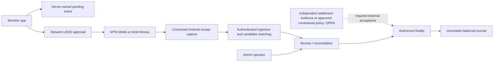

# Collect — comprehensive production readiness review

> Owner scope amended 1 October 2026: use revolut-design directly as the sole design skill. The separate mandatory mobile checklist and its gates were removed. Changed package bytes are outside previous integrity attestations; dated product observations retain their original scope.

**Decision: NO-GO for production release.** Review date: 1 October 2026, Africa/Kigali. Workspace: /Volumes/PRO-G40/Projects/Recovered-G-PRO/COOL. Local and remote main both resolved to df1150ea118aa5dcc9ecb880c71873423081bffe during this review. The working tree contains extensive additional work and continued changing during inspection; that commit does not identify the reviewed application by itself.

Collect has substantial implementation and unusually detailed local control evidence. Its financial, identity, import and operator controls deserve preservation. The release gap spans executable CI, coordinated backend delivery, some remaining authorization/privacy implementation, accurate public journeys, complete design acceptance, signed devices/stores, and demonstrable live operation. A wholesale framework rewrite is not justified by this review.

This report is the integrated decision and action plan. Its detailed contributions are [backend/security](critical-review-2026-10-01/backend-security.md), [architecture/delivery](critical-review-2026-10-01/architecture-delivery.md), and [product/design](critical-review-2026-10-01/product-design.md). They contain 40 specialist finding records before overlap consolidation, including one public-media finding subsequently corrected locally. Their individual scope, timestamps and closure requirements matter more than that count.

## 1. Required outcome, existing result and remaining gap

The required outcome is a clean, maintainable, production-ready Rwanda group-contribution system across the member app, public website, Admin PWA and backend. This review produces a researched assessment and prioritized remediation plan; it does not implement that plan, approve release or deploy changes.

The latest original register, captured at 16:21:37 UTC, retains 102 acceptance checks, of which 101 remain open: 24 P0, 71 P1, four P2, and two crosscutting entries. Its separate 24 local implementation criteria are recorded complete for specified immutable candidates. This distinction is valid. Several completed controls have evidence; completing local code does not complete provider, hosting, store, legal, physical-device or owner acceptance.

Fresh readback checked 462 hashes in two maps from that integrated local packet: 444 matched, 18 differed. Eight differences concerned Flutter/Admin/theme/package inputs and ten concerned unattended MCP inputs. The packet already disclaims whole-current-suite and visual-fidelity certification. It must not be stretched to cover those changes. The packet references a 187-migration candidate; this review's backend inventory contains 188 migrations.

During this review, a second readback found eight selected files changed and two Admin automatic-gateway files added after the 17:28 UTC baseline. The source changes were preserved. Public app screenshot provenance was subsequently repaired by parallel work and passed a scoped refresh at 17:36:55 UTC. This report retains the original failure and the correction. A new static build, served publication and complete visual acceptance were not inferred.

The [final readback at 17:43:05 UTC](critical-review-2026-10-01/source-final-readback.json) found 12 originally hashed paths changed, including additional Admin views and public layout/check inputs. The earlier command results remain dated observations; they do not accept these later edits. Review completion is not a freeze of the continuously changing application.

The remaining gap is one reviewed, reproducible release candidate with its affected checks, exact deployed contracts and all required external acceptance. A readiness percentage would obscure that gap: a single unresolved financial-finality, restricted-permission or release-authority gate can prevent GO regardless of test counts.

## 2. Scope, method and limitations

The review applied the explicitly requested [efficient-codex skill](</Volumes/PRO-G40/Agents/Codex/Operational-Installation/.agents/skills/efficient-codex/SKILL.md>) and [Plugin Management skill](</Volumes/PRO-G40/Application Data/Codex/Codex-Home/plugins/cache/openai-curated-remote/plugin-management/0.1.0/skills/plugin-management/SKILL.md>). The required [revolut-design skill](</Volumes/PRO-G40/Application Data/Codex/Codex-Home/skills/revolut-design/SKILL.md>) governed visual assessment, including its quality standard, all 60 operational checklist procedures. Supabase guidance was used for connected metadata and security/recovery research.

Coverage combined recursive inventory; source and evidence hash readback; targeted high-consequence manual review; fresh local static, unit and visual-regression checks; read-only GitHub/public-domain probes; and primary-source research. Parallel reviewers had separate report ownership and made no application fixes. The review did not read every retained snapshot or manually inspect every line. No penetration test, whole-current Flutter suite, full current database execution, authenticated production operator session, physical-device campaign, store-console review or legal opinion was performed.

| Inventory at 17:28 UTC | Observed scope | Meaning |
| --- | --- | --- |
| Git-visible files, excluding this review directory | 307,482 | Includes retained source snapshots and evidence, not 307,482 active product files |
| Documentation/evidence | 305,247 files; 30,932,849,991 bytes, about 28.8 GiB | Workspace and preservation burden; not all material is redundant |
| Selected active source/config/test/check roots hashed | 2,224 files; 157,645,348 bytes | Content-bound baseline; content and test-driver folders were inventoried but not included in this selected hash scope |
| Runtime Dart library | 269 files | Includes member, Admin and public Flutter surfaces |
| Backend reviewer scope | 188 SQL migrations, about 50,497 SQL lines; 77 Edge TypeScript files; 12 function entrypoints | Broad inventory, targeted effective-definition review |
| Individual dirty paths | 201 modified, one deleted, 296,502 untracked | 296,704 entries; the initial default status collapsed these into 1,060 entries |

Ignored build/cache/secret material was outside the Git-visible inventory. The design hygiene check separately walked ignored local references and found one competing declaration in an old cache. Private reference images were inspected locally and not copied into the report. No credentials, production customer rows, provider sends, remote SQL, deployments, store uploads or source cleanup were performed.

Full inventories and reproducible evidence are in [repository-summary.json](critical-review-2026-10-01/repository-summary.json), [compressed path inventory](critical-review-2026-10-01/repository-inventory.json.gz), [source-baseline.json](critical-review-2026-10-01/source-baseline.json), [source-readback.json](critical-review-2026-10-01/source-readback.json), and [prior-evidence-readback.json](critical-review-2026-10-01/prior-evidence-readback.json). These record review scope; they are not release approval.

## 3. Product and architecture assessment

| Boundary | Canonical entry or implementation | Responsibility |
| --- | --- | --- |
| Member app | [main.dart](/Volumes/PRO-G40/Projects/Recovered-G-PRO/COOL/lib/main.dart), [member router](/Volumes/PRO-G40/Projects/Recovered-G-PRO/COOL/lib/app/router.dart) | Member identity, groups, contribution handoff, history and supported native capabilities |
| Admin PWA | [main_admin.dart](/Volumes/PRO-G40/Projects/Recovered-G-PRO/COOL/lib/main_admin.dart), [Admin router](/Volumes/PRO-G40/Projects/Recovered-G-PRO/COOL/lib/admin/admin_router.dart) | Permission-controlled operations, evidence, approvals and recovery |
| Flutter public surface | [main_public.dart](/Volumes/PRO-G40/Projects/Recovered-G-PRO/COOL/lib/main_public.dart) | Public Flutter marketing/fallback surface; separate from generated static hosting |
| Static website | [public generator](/Volumes/PRO-G40/Projects/Recovered-G-PRO/COOL/scripts/public_static_site_build.rb) | Hosted marketing, legal routes, metadata, links and published media |
| Server authority | [functions](/Volumes/PRO-G40/Projects/Recovered-G-PRO/COOL/supabase/functions), [migrations](/Volumes/PRO-G40/Projects/Recovered-G-PRO/COOL/supabase/migrations), [config](/Volumes/PRO-G40/Projects/Recovered-G-PRO/COOL/supabase/config.toml) | Authentication, admission, matching, private data, approved finality, journals and audited actions |
| Operator automation | [MCP package](/Volumes/PRO-G40/Projects/Recovered-G-PRO/COOL/tools/collect-notification-mcp/package.json) | Scoped supervisor/gateway/scheduler protocols and durable local authority/recovery |

The intended product is coherent: Rwanda, whole RWF, MTN MoMo/Airtel Money USSD, verified member identity, private Android-created groups, platform-sponsored public groups and permission-controlled operator reconciliation. Collect records and coordinates contributions without asking for the payment-provider PIN or OTP. The payment authorization happens in the network prompt. A Collect WhatsApp sign-in code serves a separate purpose.

The financial trust boundaries are central to the readiness decision:

The diagram distinguishes implemented internal mechanics from the still-open external finality acceptance; an SMS or internal review hash is not itself independent provider settlement evidence.

The existing Flutter/Riverpod/GoRouter and Supabase architecture can support this product. Member, Admin and public entrypoints are explicit. Shared money, session, cache and UI adapters exist. Server-owned financial decisions, immutable journals, compensation, separation of duties and request-bound acknowledgements are sound directions. The public static generator and Flutter marketing surface, however, have separate content/build paths that can diverge. Multiple independent route, endpoint, acceptance and publication inventories have already drifted.

The largest maintainability risks are concentrated responsibilities, duplicated release truth and uncontrolled evidence growth. Central member repository and Admin runtime/import/shell files breach the repository's CI size policy. A large number of recently added Admin modules remain under a flat core directory. Extract by actual workflow and ownership boundary while retaining public interfaces and contracts. Flutter's official architecture guidance recommends separating UI and data responsibilities, but explicitly treats its examples as adaptable guidance; it does not require replacing Riverpod or introducing packages for every feature. [Flutter architecture guide](https://docs.flutter.dev/app-architecture/guide).

The public website is not simply a web build of the member app, and the operator PWA is not a native screen enlarged. Apply the sole selected design authority through their matching marketing, Business/operator and native references. Preserve Collect's own identity, supported capabilities and workflow. Regression captures are product evidence rather than independent design authority.

## 4. Fresh verification and live observations

| Check | Observed outcome | Practical limit |
| --- | --- | --- |
| Flutter analysis without dependency resolution | PASS; no issues, 38.3 seconds | Dated mutable-tree static check, not a signed or hosted artifact |
| Seven selected Flutter test files | 123 passed; one failed | Covers money, intent/session, unknown-data, reconciliation UI and core goldens; not the full suite |
| Failed public desktop golden | 23.36% / 302,702 differing pixels | Requires intentional-difference review or repair; does not diagnose exact Revolut fidelity |
| Eleven selected pinned/frozen/offline Deno unit files | 143 passed; zero failed | No provider, network, DB or credential grants; not all integration tests |
| Migration static checker | PASS | Historical pattern/version checks; no SQL execution or complete schema proof |
| Edge auth contract checker | FAIL | Stale endpoint/string expectations; this is not proof new handlers lack authentication |
| MCP strict type check | PASS | Local compile proof only |
| Full MCP aggregate attempted | 120-second deadline; 253 passing assertions observed, no failed assertions observed | Incomplete, never an aggregate PASS |
| Focused changed MCP authority/recovery cases | 21/21 PASS, 107.3 seconds; inputs unchanged during run | Scoped refresh, not full suite or installed host/sender acceptance |
| Sole design authority hygiene | FAIL; one ignored cache declaration | 65,055 reference files scanned; default invocation did not verify skill revision; visual acceptance remains unverified |
| Source-integrity aggregate | 90-second timeout | Includes a broad secret-scan child; no completed aggregate or secret-free conclusion |
| Mobile release gate | BLOCKED | Android artifacts/signatures and current signing approval missing/stale according to gate |
| iOS package/readiness gate | FAIL | Expects five 6.5-inch screenshots and finds one |
| Approval evidence gate | BLOCKED | Current Android signing review and accountable release-owner signoff unresolved |
| Live public website, 17:31:39 UTC | 33/36 checks passed; three failed | Copy evidence changed, four broken legal links, one performance-budget sample |
| Live Admin PWA, 17:31:21 UTC | FAIL | Five served-worker contract checks failed while static endpoints returned HTTP 200 |
| Remote main | Matches local main HEAD | Does not include dirty/untracked implementation |
| Latest eight GitHub runs sampled | All completed with startup_failure | No diagnosis of startup cause and no green current required-CI evidence |
| Main branch-protection API | HTTP 403, plan restriction | Enforcement unknown; not proof protection is absent |
| Linked Supabase metadata/advisors | INVALID_ARGUMENT; linked project absent from accessible connection list | Hosting, migration/function parity, Auth/RLS, jobs and backup state unknown; not proof of project deletion/outage |

Logs and machine summaries are [Flutter verification](critical-review-2026-10-01/flutter-verification.json), [local gates](critical-review-2026-10-01/gate-results.json), [live gates](critical-review-2026-10-01/live-gate-results.json), [public details](critical-review-2026-10-01/public-live.json), [Admin details](critical-review-2026-10-01/admin-live.json), [external readback](critical-review-2026-10-01/external-readback-summary.json), and the domain-specific evidence files alongside the reports. GitHub evidence includes the [HEAD-related Gradle run](https://github.com/ikanisa/COOL/actions/runs/36751713381) and a [recent PR run](https://github.com/ikanisa/COOL/actions/runs/36751716611).

The public performance failure measured one root GET at 1,706 ms against the repository's script budget. It is not field LCP, INP or CLS, and it does not establish a statistically representative p95. Website performance acceptance should measure user experience under defined devices/networks and, after launch, field distributions. [Google Web Vitals](https://web.dev/articles/vitals).

## 5. Consolidated critical findings and recommendations

P0 denotes an unresolved release gate with financial/security/authority consequences. P1 denotes a defect or required affected-capability acceptance before release. P2 denotes a controlled improvement. “Observed” source defects, “dated live failures”, and “unverified acceptance” remain separate below.

| Review item | Severity/type | Finding, consequence and needed work | Detailed trace |
| --- | --- | --- | --- |
| CR-01 | P0, acceptance | One immutable reviewed candidate and current hosted parity are missing. Restore exact-target read access and bind migrations, effective privileges, function bundles, Auth, jobs and clients to approved artifacts. Local source controls cannot protect a different deployed contract. | BE-01; G04/G07/G08/G09, S08, D09, Q03 |
| CR-02 | P0, financial policy | A hash and two-person reconciliation authorize an internal decision but do not authenticate provider settlement. Approve independent statement/provider evidence or a constrained finality policy, retain provenance, and prove ambiguous/corrected/reversed cases with no unsupported credit. | BE-02; F01/F02/F10 |
| CR-03 | P1, source defect | Deploy and readiness lists contain eight functions while source contains twelve. Four omitted handlers include reconciliation-finalize and gateway/supervisor/exception-worker APIs. Maintain one complete reviewed endpoint manifest, exact authority/configuration, rollout order and post-deploy denial/positive checks. | BE-03 / ARC-03; S10/Q03 |
| CR-04 | P1, source defect | Assisted SMS changes from caller JWT to service RPC and forwards user identity without the original session. Carry and revalidate the original session atomically with sensitive claim/content/confirmation/send-start operations; test both revocation orderings. | BE-04; S09/F10/A06 |
| CR-05 | P1, source/configuration | Raw-SMS retention is protected against deletion but lacks a governed purge/redaction workflow; account deletion records a request without demonstrated complete execution. Define retention/legal holds, bounded processing, session revocation, derivative handling and truthful completion receipts. | BE-05; P03/P04/P05 |
| CR-06 | P1, source/configuration | Play Integrity validation binds requests but lacks source-level per-actor/global decode admission; external mitigation was not verified. Add quota/resource fairness before Google work and explicit outage/retry behavior. Validate actual OTP spend limits, upstream abuse controls and hosted MFA availability. | BE-06/07; S03/S06/S10 |
| CR-07 | P1, CI defects | Linux CI resolves a developer-specific Dart path; four central Dart files breach its 1,200-line gate. Make tool selection portable and split actual responsibilities. Do not suppress required checks to obtain green status. | ARC-01/02; Q01/Q02 |
| CR-08 | P1, CI defects | Deno workflow lacks explicit nested frozen-lock selection, loopback/read permissions and required observation input. An observed worker test throws immediately without its argument. Wire the controlled runner and explicit generated prerequisites. | ARC-04 / BE-10; Q02/Q03 |
| CR-09 | P1, release authority | Backend deploy mutations lack immutable candidate/source approval binding; iOS upload paths have weaker candidate/environment gates than Android. Separate compile, signing, internal distribution and public release with exact source/artifact authority. | ARC-05/06; G09/M09/Q03 |
| CR-10 | P1, dated deployment/risk | Served Admin worker fails five required contracts. Stable asset URLs receive year-long immutable caching and immediate worker activation can mix versions. Repair deployment parity and prove hosted two-version first/warm/multi-tab/offline/interruption/rollback behavior. | ARC-07; O04/O05/Q03 |
| CR-11 | P1, observed/live | The public legal generator promises a form but emits zero actual form/input controls. Four live privacy/terms links lead to 404 destinations. Provide a functioning, accessible request route or accurate real contact/action; resolve every published destination. | PD-04/05/06; P03/P04/U09 |
| CR-12 | P1, product accuracy | Active insurance, basic-phone and loan-oriented marketing exceeds the approved Rwanda MoMo app contract; EUR/SEPA remains in PWA metadata. Establish reviewed availability/eligibility facts and real conversion journeys across app, web, store and help. | PD-07/10/13; P01/P02/U09 |
| CR-13 | P1, design/accessibility | Current mobile and matching cross-surface comparison remain unverified. Payment status/errors lack explicit announcement/field association; numeric fit can undermine enlarged text. Add focused semantics/layout proof and reconcile actual reader acceptance scope. | PD-01/08/09/11; U01–U10 |
| CR-14 | P1, rights/evidence | Current bundles declare Aeonik Pro without verified redistribution rights in the reviewed evidence. Local implementation authorization is not licence certification. Obtain exact font-use rights or use the supported licensed adapter; inspect produced bundle/notices and rerun affected comparisons. | PD-03/12; P09/G07/U02 |
| CR-15 | P1, failed regression | The current public desktop golden failed materially. Classify the intended change against the selected design reference, inspect actual render and repair or approve a truthful new baseline. Never regenerate goldens solely to erase the failure. | Flutter log; PD-01/12; Q02/U01 |
| CR-16 | P1, maintenance | Operational CLI fallback may fetch latest Supabase; fork comparison/update and ecosystem coverage are uneven. Pin operational binaries, verify forks and all locks, produce artifact-bound SBOM/notices, and disposition advisories by reachable shipped code. | ARC-08/09; Q04/Q05/G07 |
| CR-17 | P1, workspace/evidence | 28.8 GiB of visible evidence and 296,502 untracked files obstruct clean review and make broad checks expensive. Preserve unique sources/results, use an indexed content-addressed evidence store and remove only confirmed recoverable duplicates. | ARC-10; G08/Q06 |
| CR-18 | P1, evidence hygiene | An obsolete ignored cache declaration fails sole-authority hygiene. Remove the competing reference within preservation rules and verify the selected skill revision separately. A hygiene pass would still not certify fidelity. | PD-14; U01/G08 |
| CR-19 | P0, recovery acceptance | Current full-system restore, off-site recovery, objects/configuration/secrets/authority reconciliation and RPO/RTO are not established. Execute an authorized isolated restore and prove balances, custody, identities and no duplicate external effects. | ARC-11 / BE-09; O06/O07/D09 |
| CR-20 | P1, operations/AI | Local alerts, policy defaults and worker budgets exist; deployed limits, escalation, staffed response, restart/takeover, roster-vendor privacy/accuracy and representative capacity remain unverified. Test real approved environments and preserve default pause/emergency stop. | ARC-12 / BE-12/13; O01–O10/A01–A10 |
| CR-21 | P0/P1, native acceptance | Current Android signing/artifacts, restricted-SMS permission decision, physical lifecycle/provider corpus and current iOS package/privacy/store acceptance remain open. One screenshot-count failure is already concrete. Historical builds cannot authorize 1.2.4+23. | ARC-13; M01–M10/Q07/Q08 |
| CR-22 | P1, governance/privacy | Named accountable owners, Rwanda controller/processor evidence, cross-border authorization/contracts, provider/legal service classification and current support/complaint processes need accepted evidence. Code and non-custody wording do not establish these decisions. | P01–P10/G01–G10/O01; section 7 |

One previously observed issue is **locally corrected**: PD-02 public-media fingerprint/provenance now validates seven screenshots against the current captured runtime. Its earlier failure remains in the product evidence. Static generation, browser review, publication and complete product fidelity remain separate acceptance. This correction was parallel work, not a remediation made by this audit.

## 6. Full readiness checklist coverage

The unchanged [102-row production checklist](critical-review-2026-10-01/production-checklist-102.csv) includes original acceptance, remaining work, evidence status and accountable-person fields. Its [captured JSON](critical-review-2026-10-01/production-register-snapshot.json) preserves the actual register. The product contribution assesses **all 60 procedures** from the selected design operational checklist. Backend and delivery reports add detailed 22-domain and 18-area assessments. Coverage means each topic is assessed and its proof gap stated, not that every procedure passed or was physically executed.

| Global aspect | Assessment and required acceptance |
| --- | --- |
| Product scope and eligibility | Rwanda/RWF/MoMo contract is explicit; reconcile public claims, Android creation limits, private/public membership and unsupported-platform explanations |
| Financial accuracy and settlement | Server-owned intent, strict matching and journals are strengths; independent authenticity/finality and provider corrections/reversals remain gates |
| Money/ID/time parsing | Fresh selected exact-money/session tests pass; preserve whole RWF, bounds, immutable payer IDs, timezone/calendar validity and cross-runtime corpus |
| Identity and account lifecycle | Signed OTP and session fencing exist; hosted quotas/factors, number reassignment, recovery/deletion execution and installed switching need proof |
| Authorization, tenancy and roles | Recent permission and AAL2 controls are strong; repair assisted bridge, verify effective hosted roles/grants/RLS and revocation races |
| Device/app attestation | Request binding is implemented; add admission, validate certificate/version-bound signed builds and provider outages/replay |
| Transport, secrets and telemetry privacy | Structured redaction and protected transport exist; broad secret scan incomplete, history/ignored material and actual rotations remain evidence gaps |
| Data model and migration compatibility | Long migration chain and predecessor guards exist; derive effective schema, replay exact current clean/populated chain and prove client compatibility |
| Data volume, paging and database performance | Scoped generated-data/query evidence exists; bind it to current readers and realistic distributions, p95/p99, lock contention, scheduler and capacity budgets |
| Offline, cache and realtime | Extensive scoped account/reconnect evidence exists; hosted reconnect/revocation and physical queue/lifecycle remain separate |
| Native receipt custody and recovery | Encrypted queue/ACK identity controls are valuable; devices must prove corrupt/key-loss/quarantine/capacity/account-switch and delayed-upload handling |
| API/contract completeness | Versioned contracts exist; consolidate endpoint/route/ACK manifest and repair deployment/auth-test drift |
| AI/import/sandbox processing | Deterministic review and bounded decoder/provenance exist; live vendor region/retention/contracts, labelled accuracy and cost/abuse limits require acceptance |
| Admin workflow completeness | Current router has 28 routes; comparator inventory has 25. Prove all role/state/action/source/reason/step-up/audit and uncertain-commit journeys |
| Automation, host and operator takeover | Paused/emergency defaults and fenced protocols exist; actual enrollment/scheduler/sender/restart/revocation and stop decisions remain unverified |
| Shared design and typography | Sole authority and adapters are present; resolve licences, cache residue, revision binding, missing route/state comparators and failed public golden |
| Responsive layout and enlarged text | Valuable scoped small/large-layout evidence exists; cover changed money controls, long names, payee identity, keyboard and all supported widths |
| Web accessibility | Use WCAG 2.2 AA as review baseline; labels, errors/status, keyboard/focus, reflow, target size, contrast and complete requests require affected proof |
| Native accessibility | Use matching native semantics/tasks; actual reader proof and acceptance scope need reconciliation, independent of browser semantics snapshots |
| Geographic/language/network inclusion | Preserve Rwanda restrictions and whole-value output; test supported Kinyarwanda/English/French strings, narrow screens, low bandwidth and older eligible devices |
| Public navigation, SEO and content | Live most static checks pass; legal links/forms, truthful metadata/claims and current screenshot/content publication need repair and readback |
| PWA installation, updates and rollback | Static endpoints are available; repair served worker and prove real two-version warm updates, private-state boundaries, draft survival and offline behavior |
| Performance and battery | Do not infer field performance from a GET or fixture; define native frame/startup/memory/battery and web/database peak budgets and collect representative distributions |
| Source ownership and maintainability | Preserve modular controls; extract oversized actual responsibilities, consolidate repeated registries and document stable ownership/caller contracts |
| Dependencies, forks and licences | Dart/Edge locks and fork records exist; enforce all build locks, native checksums, provenance/advisory decisions and exact shipped notices |
| CI and independent review | Fresh local analysis is green; source-confirmed workflow issues and sampled startup failures block current independent CI acceptance |
| Builds, signing and stores | Compile evidence exists for earlier identities; current artifact/signature/store/privacy/permission/readback and exact version binding remain required |
| Hosting, DNS/TLS and deployment parity | Public origins respond over HTTPS; exact backend access/parity, approved release identities, rollout/rollback and final hosted readback remain gaps |
| Monitoring, alerting and incident response | Local metrics/response procedures are useful; configure live redacted delivery/backlog/auth/finality alerts, accountable escalation and tested response |
| Backups and continuity | DB rehearsal is scoped evidence; separately restore database, object bytes, secrets/config, cryptographic custody and external-work state under approved RPO/RTO |
| Privacy and rights | Repair request UX and execution; evidence controller/processor roles, retention, processor contracts, transfers, holds, exports and breach response |
| Legal/provider/commercial acceptance | Establish actual service classification/agreements, supported claims and fee/complaint/dispute obligations; no blanket global-law certification inferred |
| Support and launch readiness | Require named staffed pilot, representative users, daily independent reconciliation, escalation, stop/rollback criteria and final accountable GO |
| Abuse, fraud and disputes | Existing identity/matching controls help; prove forged/duplicate receipts, receiver changes, number reassignment, collusion, dispute and recovery decisions through authentic cases |
| Cost and sustainable capacity | Reservation/quotas exist; establish actual OTP/AI/storage/egress costs, projected growth, budget alerts and safe exhaustion without losing financial evidence |
| Analytics and change decisions | Operational telemetry exists; define useful privacy-governed journey metrics, consent/applicability, reliable event meaning and feedback-to-change ownership without treating a notification as delivery |

These topics cover the requested global engineering/product aspects while retaining the actual Rwanda product boundary. Expansion into another country, credit/insurance execution or a new payment rail would require a separate scoped product and legal assessment.

## 7. Research-backed acceptance baseline

Security assessment should use versioned OWASP ASVS for web/API controls and MASVS/MASTG for native storage, cryptography, authorization, platform, network and privacy tasks. They are useful test baselines, not certifications obtained by this report. An ASVS Level 2-oriented profile is a reasonable proposed baseline for this financial/private-data application, with heightened tests at finality and privileged boundaries; the security owner must adopt the exact scope. [OWASP ASVS](https://owasp.org/www-project-application-security-verification-standard/), [OWASP MASVS](https://mas.owasp.org/MASVS/).

For secure delivery, use NIST SSDF practices to connect source ownership, protected changes, dependencies, verification and vulnerability response. SLSA provenance describes build integrity and trust in how artifacts were produced; a local checksum does not automatically establish a SLSA level. Pin and protect build tools/actions and restrict publication authority. [NIST SSDF](https://csrc.nist.gov/pubs/sp/800/218/final), [SLSA security levels](https://slsa.dev/spec/v1.1/levels), [GitHub secure Actions use](https://docs.github.com/en/actions/reference/security/secure-use).

WCAG 2.2 gives the web accessibility acceptance criteria for contrast, keyboard/focus, errors, status and financial review. Browser semantics tests and screenshot diffs are useful partial proof; actual tasks and native assistive technologies remain distinct. The selected Revolut skill remains the visual authority, with W3C criteria supplying functional accessibility assessment. [W3C WCAG 2.2](https://www.w3.org/TR/WCAG22/).

Google's SMS financial-transaction exception is subject to Play review and approval. Requesting RECEIVE_SMS without READ_SMS does not remove the restricted-permission gate. Declare the actual eligible core use, minimum data access, disclosure and consent against the exact submitted package. The reviewed page also describes a future January 2027 call-log change; it must not be mistaken for a current RECEIVE_SMS prohibition. [Google Play SMS/Call Log policy](https://support.google.com/googleplay/android-developer/answer/10208820).

Apple requires accurate SDK privacy information and relevant listed-SDK manifests/signatures. Inspect the actual signed archive's merged manifests and required-reason API use rather than accepting the app-level plist alone. Current App Store content, screenshots, support/privacy paths and functioning journeys must agree with shipped capabilities. [Apple SDK requirements](https://developer.apple.com/support/third-party-SDK-requirements/), [Apple review guidance](https://developer.apple.com/app-store/review/).

Supabase security acceptance concerns effective privileges, views, function owners/search paths and Auth sessions, not only whether a table has RLS enabled. Sensitive logout guarantees require session-aware enforcement, especially across a service bridge. Backups have scope limits: database backup metadata must not be treated as a backup of actual Storage object bytes. Restore configuration, objects, credentials and external in-flight effects separately. [Supabase RLS](https://supabase.com/docs/guides/database/postgres/row-level-security), [Supabase sessions](https://supabase.com/docs/guides/auth/sessions), [Supabase backups](https://supabase.com/docs/guides/platform/backups).

For Rwanda privacy, the DPO publishes the requirement to register an intended controller/processor, and its registration form separately identifies authorization for transfer and storage outside Rwanda. Establish the actual entity, data classes, subprocessors, countries, grounds, contracts and accepted authorizations. This review did not determine whether those certificates already exist outside the repository. [DPO registration requirements](https://dpo.gov.rw/dpp-law/registration-of-a-data-controller-and-a-data-processor), [DPO registration form](https://dpo.gov.rw/fileadmin/DPO/Data-Controller-Registration-Form.pdf).

Rwanda's payment-system legal framework is activity-based. “Collect never holds funds” is a product fact to verify and an input to classification, not a concluded regulatory exemption. Review actual payment initiation, reconciliation, partner credit/insurance, agent and consumer-protection activities against current BNR instruments and provider contracts before making broader service promises. The regulator's current portal also records a 2026 replacement of the earlier non-deposit-taking regulation, illustrating why an old legal note cannot be assumed current. No conclusion on required licence or exemption is reached here. [BNR payment framework](https://www.bnr.rw/paymentsystems), [BNR non-deposit-taking framework](https://www.bnr.rw/Nondeposittaking).

Assess additional frameworks by actual data flows, markets and contractual commitments. PCI DSS addresses cardholder/authentication data and entities that can affect a card-data environment; a Rwanda MoMo-only product should have an evidenced scope decision rather than a generic claim that every payment application is PCI-certified or exempt. Revisit that decision before activating a card/partner flow. Other-country privacy and sector obligations also require an explicit applicability assessment if the real offering or processing expands. [PCI SSC intended scope](https://www.pcisecuritystandards.org/standards/pci-dss/).

Define service-level indicators around user outcomes: sign-in, intent creation, delayed receipt attention, reconciliation correctness/latency, queue custody and operator ability to recover. Select approved objectives and capacity/error budgets from actual service needs, then test alert and incident behavior. Do not invent availability percentages or an RPO/RTO as if already accepted. [Google SRE service-level objectives](https://sre.google/sre-book/service-level-objectives/).

## 8. Refactoring and restructuring plan

### Phase A — restore one executable delivery contract

Release/engineering owners should first select reviewed authored changes and record what remains staged. Use one manifest for source, locks, toolchain, build defines, migrations, endpoints, route/action state coverage and artifact identity. Keep existing production register IDs. Fix portable Dart lookup, source-size policy violations, the Deno test/lock/fixture contract, complete deploy/readiness lists and scoped iOS/backend release authority. Verify on a fresh isolated runner; diagnose GitHub startup failures separately from source failures.

This phase's exit proof is clean-runner execution of required checks and builds from the selected source, with failed/omitted scope visible. A source export that silently borrows ignored fonts, customer data, installed credentials or cached decoder fixtures is insufficient.

### Phase B — close high-consequence financial and privacy gaps

Finance/security/backend owners must resolve finality evidence and correct the assisted SMS session bridge before affected release. Preserve the working signed OTP, strict matching, two-person approval, private imports, immutable journals and compensation. Implement per-class retention and completed deletion handling, bound Integrity admission, and validate real Auth/MFA/provider configuration. Add only the negative/race/recovery tests that prove those exact boundaries.

The exit proof includes authentic authorised settlement cases, adversarial ambiguity/no-credit cases, both revocation orderings, durable uncertain outcomes, bounded admission and truthful deletion completion with required financial history retained.

### Phase C — converge public content and selected design adapters

Product/content owners should keep one typed capability/availability and legal-contact source consumed by existing Flutter/static/store/help paths. Avoid another independent visual specification. Complete functional rights-request journeys and legal links; correct currency/rail metadata and finality wording. Verify font rights and generated bundles. Bind the 37 member routes, 28 Admin routes, marketing routes, aliases, share routes and material role/theme/state variants to matching selected references.

Mobile/shared engineers should reuse existing controls for payment errors/status and adapt long monetary values/layout without undermining enlargement. Review the failed public golden deliberately. The exit proof is current reviewed renders, interactions, responsive/assistive tasks, with unsupported/comparator gaps explicitly open.

### Phase D — extract focused ownership boundaries

Split the oversized member repository by session/cache, read/history and contribution/membership responsibilities behind existing interfaces. Split Admin runtime/import/shell responsibilities into gateway/receipt, reconciliation, roster, entity-audit and shared operator/session modules. Keep common components/tokens under their existing shared adapters. Group tests with their workflow and retain transport/SQL contract tests at boundaries.

Generate effective SQL/RPC/grant documentation from an executed frozen chain so reviewers see the latest definition and callers without manually reconciling 188 historical overrides. Preserve applied migration history. Do not reorder/squash production history or add a new service/package architecture merely for cosmetic consistency.

Each extraction exits with unchanged contracts, applicable session/revocation/uncertainty tests and resolved CI size policy. Refactor in small owned increments; do not mix an architectural move with a finality-policy change.

### Phase E — preserve and reduce workspace evidence

Use the captured inventory to classify authored runtime, required regression/contract fixtures, unique historical source/results, generated build outputs and confirmed duplicates. Hash and index unique evidence privately; preserve command/toolchain/input/output relationships and failures. A content-addressed store can eliminate repeated byte copies while retaining each packet's identity and recovery route. Demonstrate archive recovery before deleting confirmed duplicates. Inspect ignored material separately before expanding cleanup scope.

Keep one concise current index per candidate and explicit superseded links. Large screenshots, source exports, SDK copies, object files and repeated partial builds should not be accidentally admitted as hundreds of thousands of unreviewed release files. The exit proof is a recoverable unique-evidence manifest, bounded clean checkout and source/dependency build that needs no private historical archive. This review deleted no existing repository or cache data.

### Phase F — complete live operation and staged release

Deployment/QA/store/operations owners should bind all environments and signed artifacts to the frozen candidate. Verify hosted contracts and privileges, real two-version PWA upgrades, Android/iOS physical journeys, authentic provider SMS corpus and permission/privacy/store decisions. Restore the whole system in isolation and validate custody, balances, objects and authority. Configure redacted alerts, staffed escalation and approved capacity/continuity objectives.

A bounded pilot needs representative users/devices, independent daily reconciliation, recoverable exception handling, a staffed support channel and explicit stop/rollback criteria. Final GO follows the existing accountable release process after required gates close. General authorization to develop or audit is not artifact-bound release approval.

## 9. Controls and evidence that should be retained

Preserve the distinction between pending intent, USSD handoff, SMS observation, reconciliation and final settlement. Preserve exact payer/receiver/amount/transaction identity; server-authored totals; no false zero on unknown summaries; encrypted receipt custody; exact durable acknowledgement before dequeue; signed request-bound attestation; bounded resource reservations; uncertain-send recovery; two-actor AAL2 approval; session-generation invalidation; immutable journals and reversals; reason-bound private reveal; deterministic/AI review separation; and paused/emergency automation defaults.

Preserve successful scoped proofs and their exact input maps, as well as failed first attempts, skipped prerequisites and incompatible-candidate observations. Current refactoring should extend those controls, not weaken tests or authority to make an aggregate appear green. Local success, integration, deployment, live behavior and acceptance remain distinct states.

## 10. Report handover and required decisions

The release owner should nominate accountable people, not only role labels, for the original open checks and the consolidated findings. Engineering leads can take CR-03/07/08/16/17 first while finance/security/privacy/product owners resolve policy and evidence dependencies in parallel. P0 gates and affected P1 defects precede public release; P2 improvements can have an explicit accepted disposition.

The immediate reviewable outputs are the three source-linked specialist reports, the unchanged 102-row checklist, the fresh command/readback packets, and this dependency-ordered plan. No application remediation, cleanup, commit, push, deployment or store submission is claimed. Production remains NO-GO pending the named implementation and acceptance evidence.
