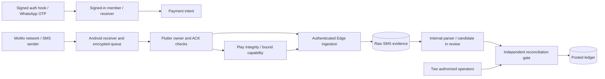

# Collect S01 threat model — receipt capture through financial posting

## 1. Overview and evidence levels

This is a bounded source model of Rwanda MoMo contribution intents and direct receiving assignments, consented Android SMS capture, server receipt acceptance, parsing and allocation, independent reconciliation, posting, Admin authority, OTP entry, and recovery storage. It describes attacker opportunities and release checks; scenarios below are hypotheses unless the source itself establishes a control discrepancy. Source line references are relative to repository root. A repository migration is **intended schema source**, while files under `deploy/hardening/` explicitly say they are staged and unapplied. Neither proves a live database state.

| Evidence level | Meaning and authority | Source |
| --- | --- | --- |
| Requested / pending intent | A signed-in member requests a Rwanda RWF contribution with a group receiver and amount. No money evidence exists. | `supabase/migrations/202605270001_sms_first_group_payment_intents.sql:116-176`; `supabase/migrations/20260925190000_rwanda_momo_only.sql:120-125` |
| USSD handed off | App opens a provider interaction; the handoff is not settlement. This model does not infer success from it. | Financial source creates review candidates and labels `ledger_posted=false` at `supabase/migrations/20260903084000_hybrid_direct_ussd_financial_core.sql:1170-1208`. |
| SMS observed | A consented receiver's app retains and submits an SMS, and a bound server receipt is stored/parsed. App and device integrity attest the request path, not the transfer. | `android/app/src/main/kotlin/app/cool/mobile/receiver_sms/CollectSmsReceiver.kt:14-50`; `supabase/functions/_shared/integrity_policy.ts:3-15`; `supabase/functions/ingest-payment-sms/index.ts:9-23` |
| Reconciled | Independently sourced evidence has been reviewed against a frozen payment candidate by separate authorized actors. This is **staged design only**. | `deploy/hardening/reconciliation_approval_v2.sql:1-3,20-35,37-74` |
| Posted | A financial finality operation creates ledger entries, marks the payment posted, and writes an audit event. This must be independently justified in the selected release. | `supabase/migrations/20260903084000_hybrid_direct_ussd_financial_core.sql:1213-1318` |

### Components and trust zones

| Zone | Principal and sensitive capability | Source |
| --- | --- | --- |
| Member and receiver Android app | Signed-in session, optional SMS consent, `RECEIVE_SMS`, device-local encrypted queue and owner-bound method channel. A provider SMS arrives from outside app trust. | `android/app/src/main/AndroidManifest.xml:9-39`; `android/app/src/main/kotlin/app/cool/mobile/receiver_sms/CollectSmsReceiver.kt:14-50`; `android/app/src/main/kotlin/app/cool/mobile/receiver_sms/SmsQueueStore.kt:30-70,105-176,230-272` |
| Supabase Auth / WhatsApp OTP | Signed webhook initiates OTP delivery; a service-role Edge client reserves quota and calls the WhatsApp provider. Possession of an OTP can create a user session. | `supabase/config.toml:377-378`; `supabase/functions/_shared/signed_sms_hook.ts:3-26`; `supabase/functions/auth-send-whatsapp-otp/index.ts:7-38` |
| Edge receipt and Play Integrity | Authenticated user submits body, envelope and capability. Google verdict checks app, device, request hash; service role mints/consumes a short-lived capability and stores the raw SMS. | `supabase/functions/verify-play-integrity/index.ts:119-151,205-282`; `supabase/functions/_shared/integrity_policy.ts:4-15`; `supabase/functions/_shared/receipt_ingestion.ts:10-27`; `supabase/migrations/20260903084000_hybrid_direct_ussd_financial_core.sql:63-148,197-266` |
| Parser and database | Internal-secret parser reads stored raw SMS, creates a parsed event, then selects a candidate payment in review. Database grants and security-definer functions form the financial authority boundary. | `supabase/functions/parse-payment-sms/index.ts:20-39,76-156`; `supabase/migrations/20260903084000_hybrid_direct_ussd_financial_core.sql:1067-1209,1718-1794` |
| Admin and financial finality | Verified WhatsApp identity, current session, role permission and separate approval are intended for reconciliation. The staged finalizer is service-only. | `supabase/migrations/20260902140151_platform_admin_whatsapp_approval.sql:30-85`; `deploy/hardening/reconciliation_approval_v2.sql:37-109` |
| Recovery storage | Raw SMS is in `raw_payment_sms`; Android receipt queue is encrypted with Android Keystore; protected snapshot is optional cache, not a ledger. | `supabase/migrations/202605230001_collect_baseline.sql:124-138`; `android/app/src/main/kotlin/app/cool/mobile/receiver_sms/SmsQueueStore.kt:194-272`; `android/app/src/main/kotlin/app/cool/mobile/security/ProtectedSnapshotStore.kt:13-72`; `lib/core/security/protected_snapshot_store.dart:4-55` |

The `Q` boundary is a proposed release requirement, not proven live: the staged SQL has no deployment evidence (`deploy/hardening/reconciliation_approval_v2.sql:1-3`; `deploy/hardening/receipt_security_v2.sql:1-2`).

### Effective sensitive resources seen in source

| Workflow | Resource and safe location | Readers / writers and enforcing control | Unresolved deployment fact |
| --- | --- | --- | --- |
| OTP delivery | Hook secrets, WhatsApp token and template environment references; no values included here. | `auth-send-whatsapp-otp` verifies HMAC, uses service role to reserve, sends via Graph API; `supabase/functions/auth-send-whatsapp-otp/index.ts:11-37`. | Real secret rotation, provider spend ceiling, signed-hook configuration and quota policy row. |
| SMS ingestion | Supabase `raw_payment_sms` stores raw body, sender, receiver binding, hashes and timestamps. | Service-only ingest RPC checks receiver/consent and limits 60/hour, 250/day; `supabase/migrations/20260815084000_atomic_sms_ingestion.sql:29-50,77-124`. | Actual table grants, backup/log destinations, retention, and whether hardening v2 is deployed. |
| Parser invocation | `SUPABASE_URL`, service-role key and `INTERNAL_FUNCTION_SECRET` references cross Edge-to-Edge boundary. | Receipt handler sends internal secret; parser requires it; `supabase/functions/ingest-payment-sms/index.ts:15-19`, `supabase/functions/_shared/supabase.ts:31-38`. | Secret scoping, rotation and deployed Edge configuration. |
| Android queued receipt | App-private `collect_sms_access` preferences, `pending_sms_encrypted_v1`, Android Keystore alias `collect_sms_queue_v1`. | Receiver writes; authenticated Flutter drain reads owner-bound queue; `android/app/src/main/kotlin/app/cool/mobile/receiver_sms/SmsQueueStore.kt:30-90,194-272`, `lib/shared/repositories/collect_repository_contribution_actions.dart:593-629`. | Physical-device consent, account switch, key-loss, backup and permission behavior. |
| Android recovery cache | `noBackupFilesDir/collect_protected_snapshot/<SHA-256 owner>.enc`, Keystore alias `collect_snapshot_v5`. | Native store limits 1 MiB and uses AES-GCM with owner AAD; `android/app/src/main/kotlin/app/cool/mobile/security/ProtectedSnapshotStore.kt:13-72`, `android/app/src/main/kotlin/app/cool/mobile/security/SnapshotCipher.kt:10-40`. | Exact persisted fields, logout/reinstall/key-loss behavior and non-Android platforms. |

## 2. Protected assets, actors, boundaries and assumptions

**Assets and invariants.** Protect OTPs and sessions, payer and receiver identities, raw SMS contents, transaction references, intent-to-contributor/receiver binding, unique provider transactions, immutable journal/balances, Admin authority, audit provenance, service-role and provider credentials. An SMS observation or integrity verdict must not itself create a posted credit. One provider transaction may create at most one posting across normal and reversal lifecycles (`supabase/migrations/20260903084000_hybrid_direct_ussd_financial_core.sql:319-339,1272-1306`). An account must not read another account's queued raw SMS (`android/app/src/main/kotlin/app/cool/mobile/receiver_sms/SmsQueueStore.kt:30-40,73-90`). A local snapshot must not be treated as financial authority (`lib/core/security/protected_snapshot_store.dart:4-5`).

**Starting actors.** An unauthenticated caller can submit requests to public Edge endpoints but has neither a valid HMAC hook secret nor a user session. An ordinary member can authenticate, request intents, and submit data for their own account; they do not gain service-role or Admin RPC authority. A consented receiver controls their Android device and can observe or alter locally supplied text under device-compromise assumptions; Play Integrity constrains eligible app/device requests but does not authenticate the MoMo transfer. A malicious SMS sender may control sender label/body within carrier/device constraints. A compromised Edge secret or service role is a higher-privilege incident scenario, not an ordinary caller capability. An authorized Admin can propose or approve within assigned permissions; collusion or account compromise is a separate prerequisite. The WhatsApp provider, Google Play Integrity, MoMo/provider statements, Supabase, and host backups are external trust domains whose live configuration was not inspected.

**Boundary B1 — OTP webhook to account session.** `verify_jwt=false` is intentional for the Auth hook, so HMAC signature/timestamp and persistent replay/limits must be decisive (`supabase/config.toml:377-378`; `supabase/functions/_shared/signed_sms_hook.ts:3-26`). The current handler calls `reserve_signed_otp_v2`, which exists only in staged SQL (`supabase/functions/auth-send-whatsapp-otp/index.ts:22-37`; `deploy/hardening/signed_otp_limits_v2.sql:1-2,22-53`). An unconfigured or missing policy fails service availability in source; actual provider and quota behavior remains unverified.

**Boundary B2 — outside SMS to device queue.** Receiver filters plausible incoming MoMo messages, excludes failed/reversal/OTP text, bounds body and queue size, and avoids sensitive logs (`android/app/src/main/kotlin/app/cool/mobile/receiver_sms/CollectSmsReceiver.kt:24-78,109-120`). This is capture eligibility, not provider authenticity; sender/body can be spoofed upstream. The queue enforces owner/consent and AES-GCM persistence, preserves ciphertext on read failure, and clears on explicit disable (`android/app/src/main/kotlin/app/cool/mobile/receiver_sms/SmsQueueStore.kt:30-70,96-176,194-272`). Owner ID is supplied by the app process; server authentication remains the authoritative account check (`android/app/src/main/kotlin/app/cool/mobile/MainActivity.kt:167-203`; `supabase/functions/ingest-payment-sms/index.ts:10-14`).

**Boundary B3 — device/app to server evidence.** Play Integrity validates package, version, certificate, app licensing, device verdict, freshness and exact request hash (`supabase/functions/_shared/integrity_policy.ts:4-15`). A capability binds user, receiver hash, envelope, sender, body hash and timestamp, and is consumed once (`supabase/functions/verify-play-integrity/index.ts:205-282`; `supabase/migrations/20260903084000_hybrid_direct_ussd_financial_core.sql:88-148,197-257`). Receipt v2 rechecks body hash and exact existing replay identity, then ACKs only a stored receipt (`deploy/hardening/receipt_security_v2.sql:7-48`; `supabase/functions/_shared/receipt_ingestion.ts:10-27`; `lib/core/security/durable_sms_receipt.dart:21-60`). The v2 SQL is staged. The app retains queue content if a validated ACK is unavailable (`lib/shared/repositories/collect_repository_contribution_actions.dart:611-629`).

**Boundary B4 — raw SMS to candidate.** Internal-secret parser reads the raw row, applies deterministic parsing, persists a parsed event, and allocates a candidate (`supabase/functions/parse-payment-sms/index.ts:30-39,76-156`). The later financial migration requires incoming RWF, positive amount, transaction reference, confidence at least 0.90, receiver/intent/payer matching and device attestation; the resulting payment is `review` with no ledger posting (`supabase/migrations/20260903084000_hybrid_direct_ussd_financial_core.sql:1096-1208,1718-1794`). An enabled direct-assignment branch instead matches an active receiving route and member by normalized MoMo name plus last three payer digits; it also creates only a review candidate (`supabase/migrations/20260903084000_hybrid_direct_ussd_financial_core.sql:1594-1647,1669-1714,1843-1957`). The parser's response is `awaiting_reconciliation` (`supabase/functions/parse-payment-sms/index.ts:13-18,144-155`). Whether all these definitions, feature flags and grants exist in the live target remains unverified.

**Boundary B5 — candidate to posted money.** The historical service-only `finalize_attested_payment_sms` calls `process_provider_finality_event` using the attestation request hash and raw SMS identifiers (`supabase/migrations/20260903084000_hybrid_direct_ussd_financial_core.sql:1479-1556,2406-2409`); that is a source-level self-confirmation path if still deployed and invoked by a service-role caller. A new additive containment migration changes the finalizer to return `awaiting_reconciliation` without posting (`supabase/migrations/20260928160000_sms_observation_never_settles.sql:1-36`). It passed an isolated full-schema replay and synthetic historical-row upgrade, but is unapplied to an authorized hosted target. The separate staged receipt v2 also specifies await-only finality; staged reconciliation requires AAL2, `payments.allocate`, a different approver, frozen payment fingerprint, short approval lifetime, and a service-only finalizer (`deploy/hardening/receipt_security_v2.sql:1-2,50-60`; `deploy/hardening/reconciliation_approval_v2.sql:1-3,37-109`). `process_provider_finality_event` and `confirm_provider_payment` remain service-role executable in the historical migration (`supabase/migrations/20260903084000_hybrid_direct_ussd_financial_core.sql:2388-2409`), so capability inventory must cover every service-role caller and wrapper before granting finality assurance.

**Boundary B6 — Admin and sensitive data.** Admin eligibility checks verified WhatsApp phone, explicit approval, current session and platform role/permission (`supabase/migrations/20260902140151_platform_admin_whatsapp_approval.sql:30-85`). Raw SMS reveal requires `sms.raw.reveal`, a reason and two audit records (`supabase/migrations/202605230008_admin_panel.sql:702-719`); ordinary authenticated read grants omit `raw_body` (`supabase/migrations/202605230008_admin_panel.sql:741-762`). Phone hashes are plain SHA-256 of normalized numbers, which supports matching but should not be considered anonymization of a small phone-number space (`supabase/functions/_shared/hash.ts:24-30`). Source cannot establish live RLS, logged output, backups or retention.

## 3. Prioritized attacker stories and mitigations

Severity is conditional on the stated prerequisite and effective deployed controls. These are **review scenarios**, not claims of exploitation.

| Priority | Scenario / new capability | Prerequisite and impact | Source controls and gap | Mitigation / decision |
| --- | --- | --- | --- | --- |
| **High conditional** | **T01: observed SMS becomes posted credit without independent money evidence.** An actor able to cause an attested, matched SMS and invoke a service-role finalizer gains a ledger credit. | Requires matching receiver, payer/intent, eligible device and a service-role invocation path. If historical finalizer is deployed, it manufactures provider finality from SMS-derived values; affected asset is ledger integrity. | Historical path `supabase/migrations/20260903084000_hybrid_direct_ussd_financial_core.sql:1479-1556`; current parser does not call it and labels observation at `supabase/functions/parse-payment-sms/index.ts:13-18,144-155`; additive await-only migration is local and untested/unapplied at `supabase/migrations/20260928160000_sms_observation_never_settles.sql:1-36`; separate staged replacement at `deploy/hardening/receipt_security_v2.sql:1-2,50-60`. | Read back deployed definitions/grants and caller inventory; remove SMS self-finality; approve independent provider/statement evidence and reversal policy before posting. |
| **High conditional** | **T02: compromised service-role key or internal secret reaches finality or raw financial data.** | Requires privileged secret compromise or mis-scoped worker, not a public caller. Impact includes false credits, raw SMS exposure, and evidence tampering. | Service client uses `SUPABASE_SERVICE_ROLE_KEY` at `supabase/functions/_shared/supabase.ts:4-9`; receipt-to-parser forwards that key and internal secret at `supabase/functions/ingest-payment-sms/index.ts:15-19`; current financial RPCs grant service role at `supabase/migrations/20260903084000_hybrid_direct_ussd_financial_core.sql:2388-2409`. | Inventory secret recipients and all service-role RPC callers, narrow finality grants, rotate and audit credentials, negative-test bypass paths. |
| **High conditional** | **T03: bogus or replayed SMS claims another payment.** A malicious sender or compromised receiver supplies a plausible receipt with a known reference, amount and payer clue. | Requires eligible app/device, current consent, matching route/intent or active direct assignment, and parser thresholds. If candidate is posted without independent evidence, wrong balance or impersonated contribution follows. Direct assignment's name plus last-three match increases the need to verify payer identity independently. | Capture filter `android/app/src/main/kotlin/app/cool/mobile/receiver_sms/CollectSmsReceiver.kt:109-120`; capability binding `supabase/migrations/20260903084000_hybrid_direct_ussd_financial_core.sql:197-257`; unique transaction and review status `supabase/migrations/20260903084000_hybrid_direct_ussd_financial_core.sql:319-339,1142-1208,1843-1957`. None authenticates provider funds. | Verify provider or controlled statement against immutable transaction reference, receiver, amount, date and payer; hold ambiguous cases; test replay/reversal lifecycle and direct-assignment collisions. |
| **High conditional** | **T04: two Admin accounts collude or one compromised account obtains both approval and execution through stale access.** | Requires privileged account compromise/collusion or broken session/revocation fence. Impact is unauthorized finality. | Staged different-actor, AAL2, fingerprint, expiry and revocation checks `deploy/hardening/reconciliation_approval_v2.sql:37-105`; Admin eligibility `supabase/migrations/20260902140151_platform_admin_whatsapp_approval.sql:30-85`. Reconciliation SQL not applied. | Finance/security approve evidence source and dual control; run concurrent approve/revoke/consume tests against deployed schema; keep service finalizer out of Admin clients. |
| **Medium conditional** | **T05: OTP replay, enumeration or cost abuse.** A caller without a session attempts repeated signed-hook deliveries or a compromised hook secret creates OTP spend. | Requires signed-hook path; secret theft broadens reach. May cause account takeover if OTP is intercepted, or provider cost/availability loss. | HMAC, timestamp and body cap `supabase/functions/_shared/signed_sms_hook.ts:3-26`; per-phone atomic five/ten-minute control `supabase/migrations/20260914213600_atomic_otp_rate_limit.sql:20-59`; global limits/idempotence only staged `deploy/hardening/signed_otp_limits_v2.sql:1-2,22-53`. | Prove deployed reservation tables/policy and concurrent replay tests; configure spend ceilings and alerting; test provider timeout, unresolved send, and secret rotation. |
| **Medium** | **T06: queued receipt is lost, cross-account exposed, or falsely ACKed during permission/session changes.** | Requires device key loss, process crash, account switch or untrusted client state. Impact is missing evidence or local privacy leak; no direct ledger credit is established. | Owner/consent, ciphertext preservation, ACK hash checks `android/app/src/main/kotlin/app/cool/mobile/receiver_sms/SmsQueueStore.kt:30-40,73-90,105-176,194-272`; Dart owner checks and ACK `lib/shared/repositories/collect_repository_contribution_actions.dart:593-629`; backup disabled `android/app/src/main/AndroidManifest.xml:24-31`. | Physical-device UAT for sign-out/login, permission revocation, full queue, corrupt/key-lost queue and commit-timeout retry; define recovery and exception ownership. |
| **Medium** | **T07: raw SMS, phone identifiers or local recovery snapshot leak through a privileged view, logs, backups or export.** | Requires authorized role misuse, host compromise or weak retention/backup policy. Impact is payer/receiver privacy exposure. | Raw reveal audit and column grants `supabase/migrations/202605230008_admin_panel.sql:702-762`; protected cache `android/app/src/main/kotlin/app/cool/mobile/security/SnapshotCipher.kt:10-40`; raw SMS deletion blocked pending governed retention `supabase/migrations/20260903084000_hybrid_direct_ussd_financial_core.sql:373-386`. | Export live grants and log sinks; inspect actual stored fields; approve purpose/access/retention and deletion-hold schedule; rehearse restore/deletion. |
| **Medium conditional** | **T08: parser or ingestion retries stall receipts or duplicate work.** | Requires provider/Edge timeout, lease loss or volume above 60/hour / 250/day per receiver. Impact is unavailable/late evidence or manual exception backlog. | Atomic receiver quotas `supabase/migrations/20260815084000_atomic_sms_ingestion.sql:49-85`; parser lease/replay repair `supabase/functions/parse-payment-sms/index.ts:40-83,127-163`; strict ACK and mobile retention `supabase/functions/_shared/receipt_ingestion.ts:23-27`, `lib/shared/repositories/collect_repository_contribution_actions.dart:611-629`. | Rehearse timeout before/after DB commit, parser crash, quota exhaustion and operator recovery; monitor queue age, parse failures and unmatched receipts. |

## 4. Severity calibration and confidence

- **Critical** would require an unauthenticated, repeatable route to arbitrary posted credits or broad credential/data compromise in an actually exposed deployment. Source inspection did not establish that route.
- **High** applies to a realistically reachable false posting, service-role finality bypass, or systemic financial evidence failure. T01–T04 remain conditional because deployed SQL, caller privileges and independent evidence are unknown.
- **Medium** applies to scoped account takeover or provider spend abuse, receipt availability loss, raw SMS exposure, or exception backlogs with bounded access. T05–T08 need deployment and device tests to calibrate likelihood.
- **Low** applies to an isolated self-only UI/cache error without financial or cross-account impact; no material story above was downgraded to Low merely because a test was absent.

The local source supports the named controls and discrepancies. It does **not** prove current deployment, actual external provider authenticity, production exploitability, legal/privacy clearance, or owner acceptance. In particular, Play Integrity proves app/device/request properties, not payment finality (`supabase/functions/_shared/integrity_policy.ts:3-15`).
